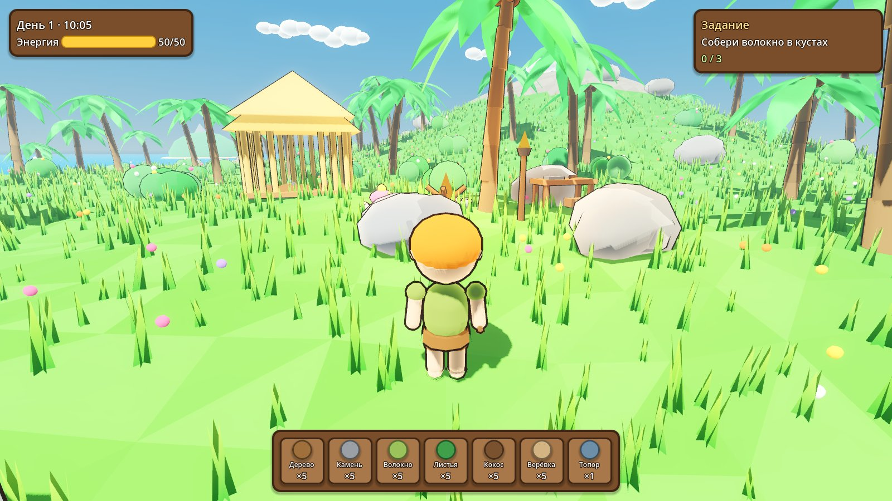

# Затерянный остров *(рабочее название)*

Уютная 3D-выживалка на тропическом острове для ПК, на **Godot 4**.
Вдохновлена мобильными «островными» играми из детства (собирай, крафти, строй, исследуй острова),
а визуальный стиль — мультяшный low-poly с toon-освещением, в духе современных кооп-игр вроде PEAK.




## Что нужно скачать, чтобы запустить

1. **Godot Engine 4.5** (или новее), *стандартная* версия, **не .NET**:
   https://godotengine.org/download — для Windows это один `.exe` (≈ 70 МБ), установка не нужна.
2. **Git** (чтобы скачивать обновления проекта): https://git-scm.com/downloads
   *или* просто скачай архив репозитория с GitHub (кнопка **Code → Download ZIP**).
3. *(позже, по желанию)* **Blender** для своих 3D-моделей: https://www.blender.org/download/

Требования к ПК скромные: любая видеокарта с поддержкой Vulkan (GTX 900+/RX 400+/Intel UHD 620+).
На очень старых ПК в Godot можно переключить рендерер на *Compatibility* (правый верхний угол редактора).

## Как запустить

1. Склонируй репозиторий: `git clone https://github.com/griwka/Robinzon.git`
2. Запусти Godot → **Import** → выбери файл `project.godot` в папке проекта → **Import & Edit**.
3. Первый запуск импортирует ресурсы (несколько секунд).
4. Нажми **F5** (или ▶ в правом верхнем углу) — игра запустится.

## Управление

| Клавиша | Действие |
|---|---|
| WASD, Shift, Пробел | ходьба, бег, прыжок |
| Мышь, колёсико | камера, приближение |
| ЛКМ / E (можно удерживать) | собирать, рубить, использовать постройку |
| Q | съесть лучшую еду (+энергия) |
| C | крафт |
| B | строительство (ЛКМ — поставить, R — повернуть, ПКМ — отмена) |
| F1 / H | справка |
| F5 / F9 / F10 | сохранить / загрузить / новая игра |
| Esc | освободить мышь / закрыть окно |

Игра автоматически сохраняется каждые 90 секунд и при выходе.

## Что уже есть (прототип v0.1)

- Процедурный остров: пляж, холмы, гора, трава, цветы; бирюзовая вода с пеной у берега; облака и силуэты дальних островов.
- Смена дня и ночи (8 минут), закаты, ночное освещение от костров и факелов.
- Чиби-персонаж с «резиновой» анимацией (наклоны, болтающаяся голова, сплющивание при прыжке).
- Ресурсы: пальмы (трясти — кокосы и листья, рубить топором — древесина), кусты, валуны (кирка), камешки, плавник, ракушки. Всё вырастает снова.
- Энергия: каждое действие тратит 1, восстанавливается сама, едой и сном в хижине.
- Крафт: верёвка, каменный топор, доски, кирка, печёный кокос (у верстака и костра).
- Строительство на сетке с превью: костёр, факел, верстак, хижина, клумба, плот.
- Цепочка из 13 обучающих заданий, финал — отплыть на плоту.
- Сохранение и загрузка.

## Структура проекта

```
project.godot          настройки проекта
scenes/main.tscn       главная сцена (всё остальное создаётся из кода)
scripts/
  game.gd              глобальное состояние: предметы, рецепты, постройки, задания, сохранения
  main.gd              сборка мира, небо и день/ночь, связь систем
  island.gd            генерация острова, воды, травы и расстановка ресурсов
  player.gd            персонаж, камера, анимация, взаимодействие
  resource_node.gd     добываемые ресурсы
  building.gd          постройки и их действия
  build_system.gd      режим строительства
  hud.gd               интерфейс
  models.gd            процедурные low-poly модели (временная графика)
  dev_tools.gd         скриншоты и автотест для разработки
shaders/               toon, контур, вода, трава
docs/DESIGN.md         дизайн-документ и план развития
```

**Баланс правится в `scripts/game.gd`**: там все предметы, рецепты, цены построек и задания.

## Для разработки

Автотест игрового цикла (крафт, стройка, задания, сохранения):

```
godot --headless --path . -- --autotest
```

Скриншот: `godot --path . -- --shot=shot.png --time=0.45 --demo`
