# Затерянный остров *(рабочее название)*

Уютная 3D-игра про жизнь на тропическом острове для ПК, на **Godot 4**.
Вдохновлена мобильными «островными» играми из детства (грядки, животные, крафт, стройка, сюжет с островами),
а визуальный стиль — рисованный мультяшный 3D с контурами и toon-освещением, в духе PEAK.
Без энергии и таймеров: играешь в своём темпе.

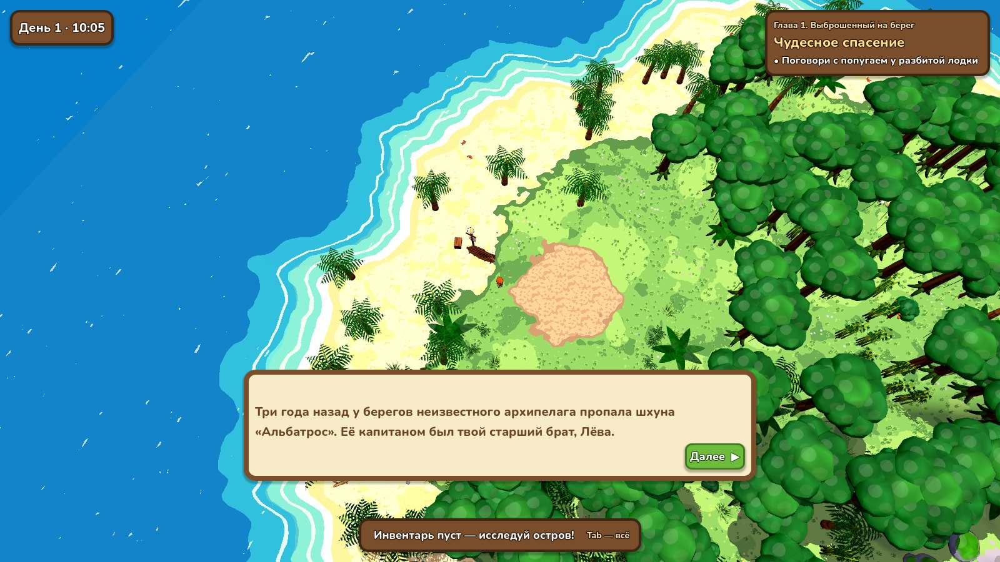
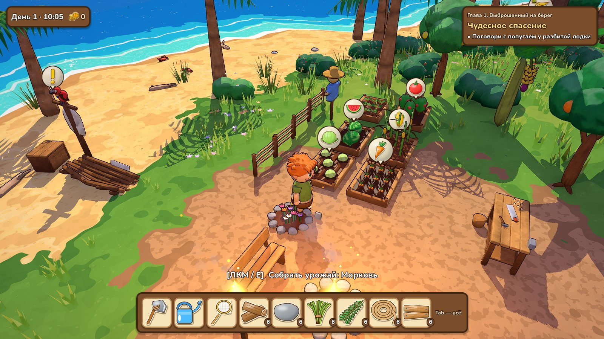
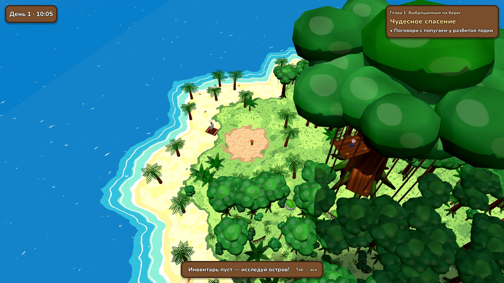
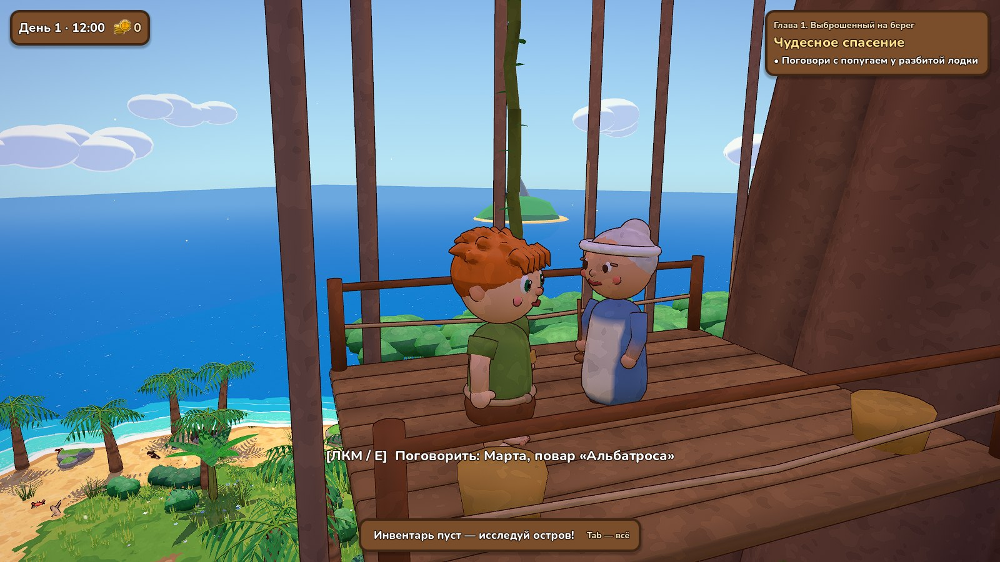
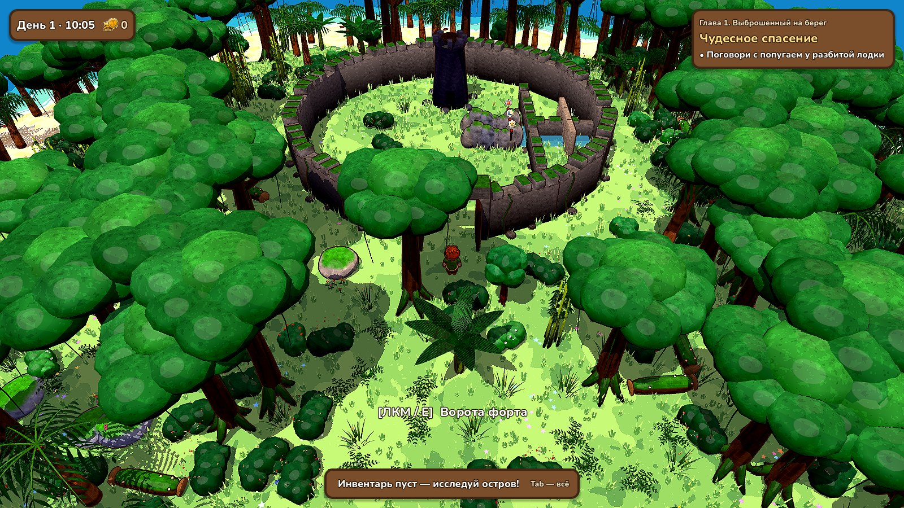
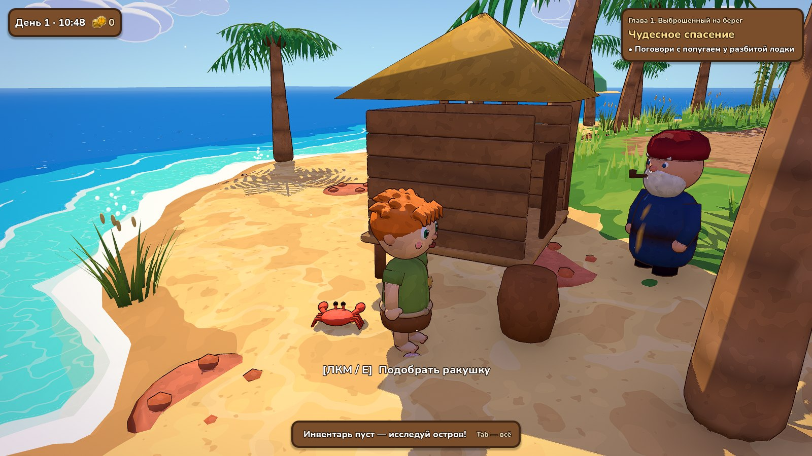
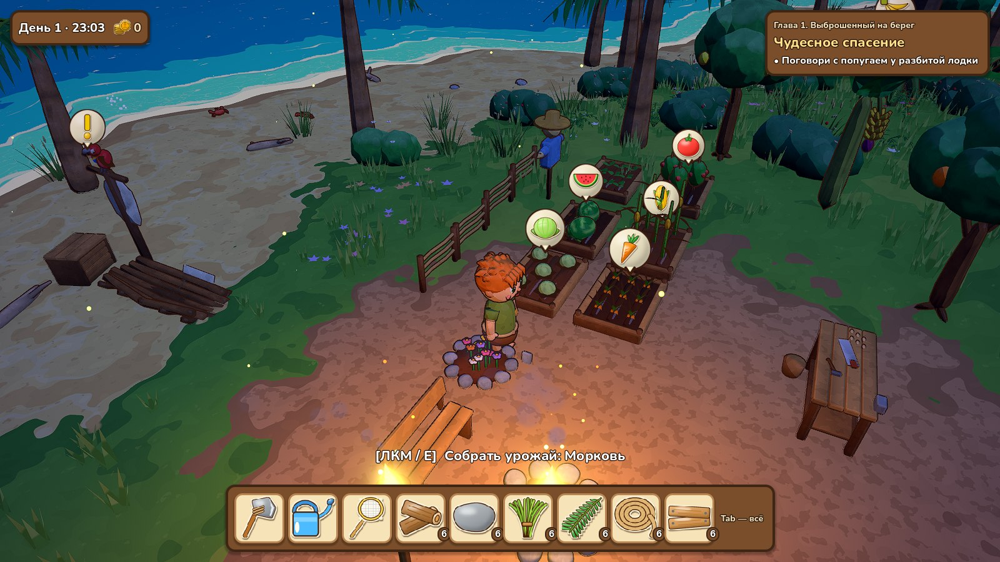
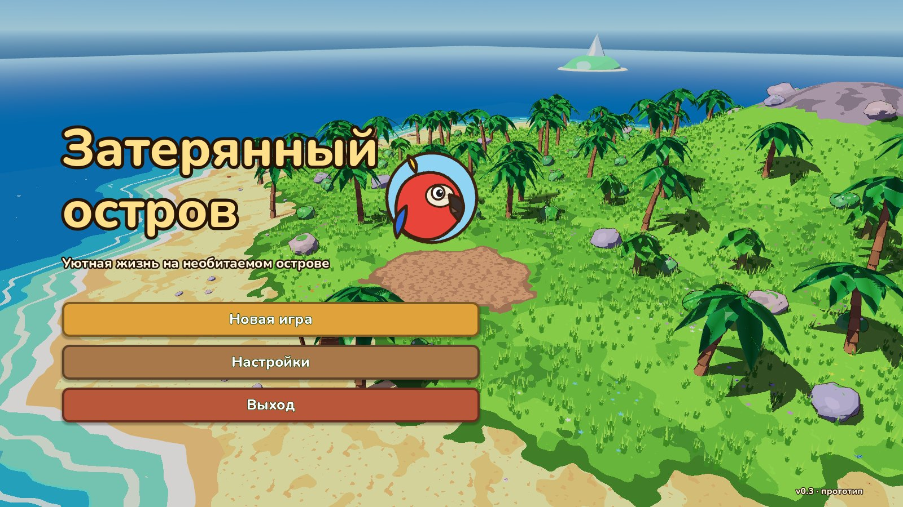
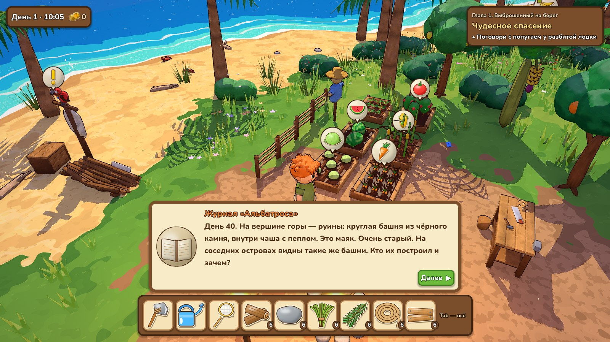
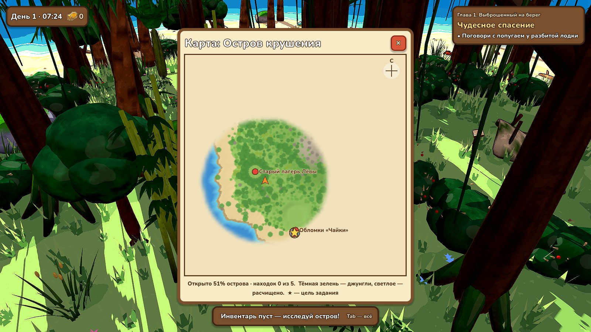
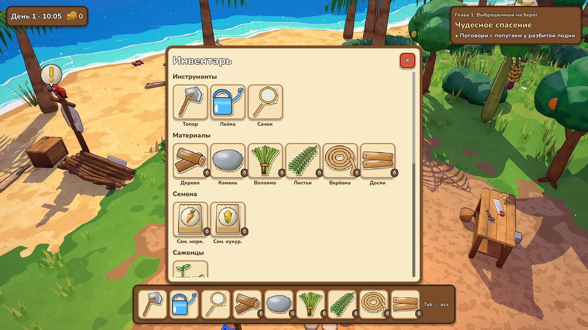

## Что нужно скачать, чтобы запустить

1. **Godot Engine 4.7** (или новее), *стандартная* версия, **не .NET**:
   https://godotengine.org/download — для Windows это один `.exe` (≈ 70 МБ), установка не нужна.
2. **Git** (чтобы скачивать обновления проекта): https://git-scm.com/downloads
   *или* просто скачай архив репозитория с GitHub (кнопка **Code → Download ZIP**).
3. *(позже, по желанию)* **Blender** для своих 3D-моделей: https://www.blender.org/download/

Требования к ПК скромные: любая видеокарта с поддержкой Vulkan (GTX 900+/RX 400+/Intel UHD 620+).
На очень старых ПК в Godot можно переключить рендерер на *Compatibility* (правый верхний угол редактора).

## Как запустить

1. Склонируй репозиторий: `git clone https://github.com/griwka/Robinzon.git`
2. Запусти Godot → **Import** → выбери файл `project.godot` в папке проекта → **Import & Edit**.
3. Первый запуск импортирует ресурсы (несколько секунд).
4. Нажми **F5** (или ▶ в правом верхнем углу) — игра запустится.

## Управление

| Клавиша | Действие |
|---|---|
| WASD, Shift, Пробел | ходьба, бег, прыжок |
| Мышь, колёсико | камера, приближение |
| ЛКМ / E | собирать, рубить, сажать, поливать, кормить, гладить, говорить |
| C / B | крафт / строительство (ЛКМ — поставить, R — повернуть, ПКМ — отмена) |
| Пробел у лианы | лезть (W/S — вверх/вниз, Пробел — спрыгнуть) |
| Q | поесть — восстанавливает силы |
| E у бурлящей воды | рыбалка: закинуть, а когда клюёт — подсечь |
| Tab | инвентарь |
| J / K | журнал заданий / коллекции |
| M | карта острова (дорисовывается там, где побывал) |
| F1 / H | справка |
| F5 / F9 | сохранить / загрузить |
| Esc | пауза, настройки, выход в меню |

Игра сама сохраняется каждые 90 секунд и при выходе.

**Полное описание игры, сюжета всех 8 глав, механик и устройства проекта — в [ОПИСАНИЕ.md](ОПИСАНИЕ.md).**
**Полный сценарий всех глав с репликами и двумя финалами — в [СЦЕНАРИЙ.md](СЦЕНАРИЙ.md).**

## Версия 0.7.1 — карта и остров

- **Карта острова (M):** рельеф, берег, джунгли и расчищенные места; туман над неисследованным;
  лагерь, сюжетные места, жители, рыбалка, находки, цель задания и сам герой.
- **Компас задания** вверху экрана (стрелка, название, метры) и метка «!» над целью, видная сквозь заросли.
  Если цель на другом острове — ведёт к плоту.
- **Кольцо подсветки** вокруг объекта, с которым сейчас будет действие (красноватое — нет инструмента);
  в подсказке — сколько ударов осталось; в строительстве — почему здесь ставить нельзя.
- **Находки:** бутылки с записками на пляжах и тайники команды «Альбатроса» в чаще (по 5 на остров).
- **Расстановка:** заросли больше не налезают друг на друга и на хижину, ящик, причал и глину;
  пальмы растут рощами, в чаще есть солнечные поляны.

## Что есть в версии 0.7

- **Глава 3 «Старый форт» (12 заданий):** боцман Стёпа, рыбалка с подсечкой, поросёнок роет трюфели,
  глина, печь и кирпичи, ворота форта на ключ, затопленный подвал с головоломкой из трёх рычагов,
  древние рисунки на стенах (тайна маяков), огонь в башне форта открывает путь к Грозовому острову.
- Новые модели: стены и ворота форта, караулка, рычаги, хижина и сам Стёпа, свинья, свинарник, печь, глиняная яма,
  удочка и лопата; новые иконки рыб, рисунки на стенах.

## Версия 0.6

- **Глава 2 целиком (13 заданий):** после чаши огня — лавка Марты, пасека, обезьянка Кешью с ключом,
  отстройка дома Лёвы на дереве и его сундук, овцы и шерсть, каноэ к Старому форту.
- **Экономика на монетах:** урожай и продукты фермы продаются Румбе и Марте; за монеты покупаются гвозди,
  рамка улья, овца — то, без чего сюжет не идёт дальше. Семена в лавке есть всегда.
- **Защита от тупиков:** что сделано заранее — засчитывается; еда для задания не съедается и не продаётся;
  валидатор проверяет выполнимость всех заданий и хватает ли страниц журнала.
- **Чёткая картинка:** контуры в пикселях, резкие тени, рисованная фактура, настройка «Чёткость картинки».

## Версия 0.5

- **Два острова и плавание.** Плот у кромки воды открывает выбор острова. У каждого острова свои постройки
  и своя расчистка; всё сохраняется.
- **Глава 2 — остров Великого Баньяна (пролог, 7 заданий).** В центре — исполинское дерево ~30 м
  с тремя ярусами. К корням прорубаешься через завесы лиан, плетёшь перчатки лазальщика и поднимаешься по лианам.
  На втором ярусе живёт Марта, повар «Альбатроса», — она поддерживает огонь и знает, куда ушёл Лёва.
- **Лазание в духе PEAK:** Пробел у лианы — лезть, W/S — вверх/вниз, Пробел — спрыгнуть. Подъём тратит силы
  (жёлтая полоска), на земле они восстанавливаются, а еда (Q) возвращает их прямо на лиане.

## Версия 0.4

- **Остров зарос.** Свободна только полянка у места крушения. Дальше — джунгли: трава и папоротник (руками),
  колючий кустарник и бамбук (мачете), деревья-гиганты и поваленные стволы (топор), валуны и каменные гряды (кирка).
  Расчищенное остаётся расчищенным навсегда (сохраняется).
- **Сюжетные места в глубине острова:** заросший лагерь Лёвы на западе, шлюпка «Альбатроса» за скалами на севере,
  древний маяк из чёрного камня на вершине. Добраться можно только с нужными инструментами.
- **Сюжет главы 1 (22 задания):** поиски брата Лёвы. Финал — зажечь древний маяк, и с соседнего острова отвечает огонь.
- **3D-модели из Blender:** герой, попугай Румба, курица, коза, краб; 3 вида пальм, банановое, манговое и лимонное
  деревья, деревья-гиганты, бамбук, папоротники, кусты, цветы, камни и гряды; все постройки, грядки и 6 культур;
  инструменты в руке. Всего ~65 моделей, все строятся скриптами (`tools/blender/`).
- **Иконки, звук, меню** — как в 0.3: рисованные иконки в стиле оригинала, синтезированные музыка и звуки, меню и настройки.
- **Ферма и хозяйство:** грядки с поливом, фруктовые деревья, курятник и коза, бабочки, коллекции, декор. Энергии нет.

Полный план игры на 8 глав — в [docs/DESIGN.md](docs/DESIGN.md).

## Структура проекта

```
project.godot          настройки проекта
scenes/main.tscn       главная сцена (всё остальное создаётся из кода)
scripts/
  data.gd              ВЕСЬ КОНТЕНТ: предметы, рецепты, постройки, грядки, животные, коллекции, задания
  game.gd              состояние игры: инвентарь, задания, открытия, время, сохранения
  main.gd              сборка мира, небо и день/ночь, связь систем
  garden_bed.gd        грядка;  fruit_tree.gd — деревья;  animal_pen.gd / animal.gd — животные
  npc.gd               попугай Румба;  supply_crate.gd — ящик с корабля;  critters.gd — бабочки, крабы, светлячки
  island.gd            генерация острова, воды, травы и расстановка ресурсов
  player.gd            персонаж, камера, анимация, взаимодействие
  resource_node.gd     добываемые ресурсы
  building.gd          постройки и их действия
  build_system.gd      режим строительства
  hud.gd               интерфейс
  models.gd            процедурные low-poly модели (временная графика)
  dev_tools.gd         скриншоты и автотест для разработки
  map_screen.gd        карта острова;  quest_guide.gd — компас задания;  find_spot.gd — находки
  audio.gd             музыка, атмосфера, эффекты (autoload Audio)
  menu.gd              главное меню, пауза, настройки
assets/                иконки, звуки, шрифт Nunito (OFL)
tools/                 генераторы иконок и звуков (Python)
tools/blender/         все 3D-модели игры (Blender как Python-модуль bpy)
shaders/               toon, земля, контур, вода, трава, крылья бабочек
docs/DESIGN.md         дизайн-документ и план развития
```

**Контент и баланс правятся в `scripts/data.gd`**: там все предметы, рецепты, постройки, культуры, задания и диалоги.

## Для разработки

Проверка сюжета и автотесты обеих глав (с торговлей, лазанием и сценариями ошибок игрока):

```
godot --headless --path . -- --validate
godot --headless --path . -- --autotest
godot --headless --path . -- --autotest --location=banyan --chapter=2
godot --headless --path . -- --autotest --location=fort --chapter=3
```

Пересобрать модели (нужен Python 3.13 и `pip install bpy`): `python tools/blender/build.py`

Скриншот с демо-лагерем: `godot --path . -- --shot=shot.png --time=0.42 --demo --frames=150`

Карта острова картинкой (работает и без экрана): `godot --headless --path . -- --mapshot=map.png --location=fort`
Отчёт о расстановке (наложения, подходы, состав зарослей): `godot --headless --path . -- --layout --location=banyan`
