# Затерянный остров *(рабочее название)*

Уютная 3D-игра про жизнь на тропическом острове для ПК, на **Godot 4**.
Вдохновлена мобильными «островными» играми из детства (грядки, животные, крафт, стройка, сюжет с островами),
а визуальный стиль — рисованный мультяшный 3D с контурами и toon-освещением, в духе PEAK.
Без энергии и таймеров: играешь в своём темпе.


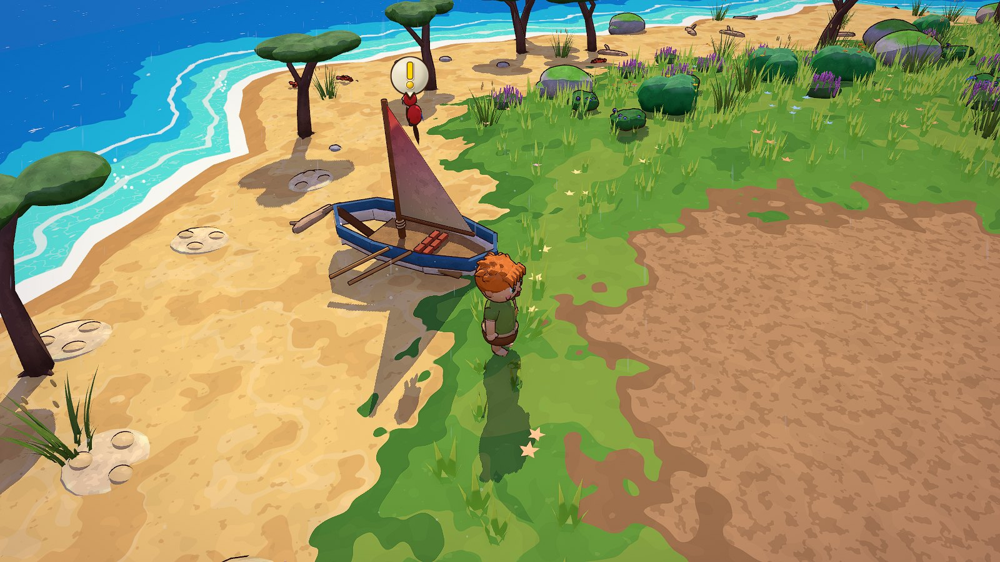
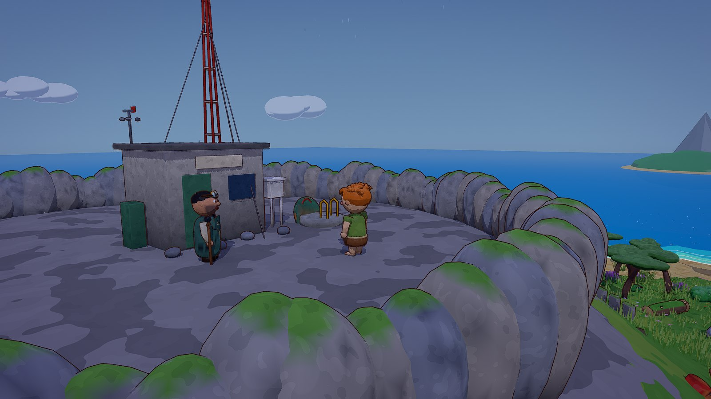
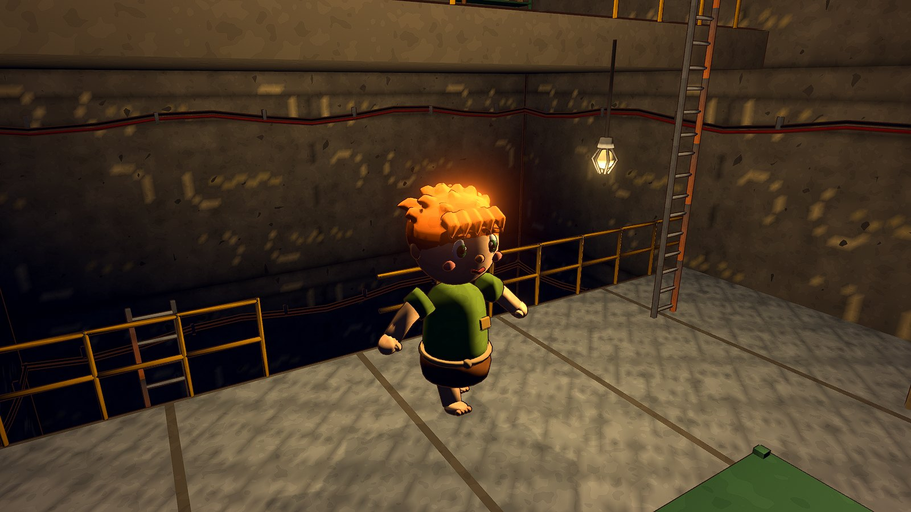
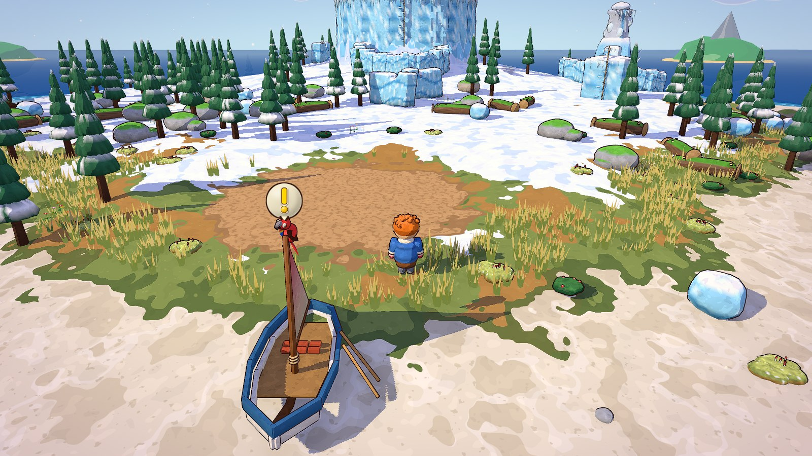
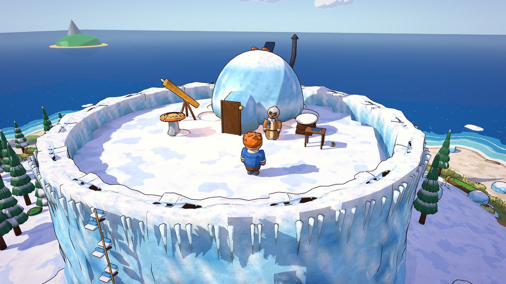
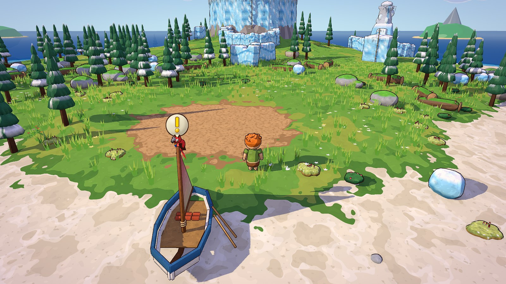
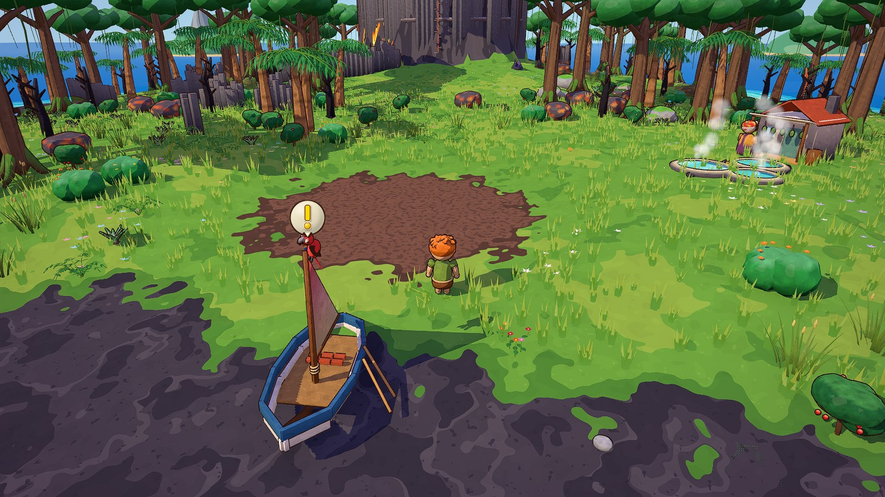
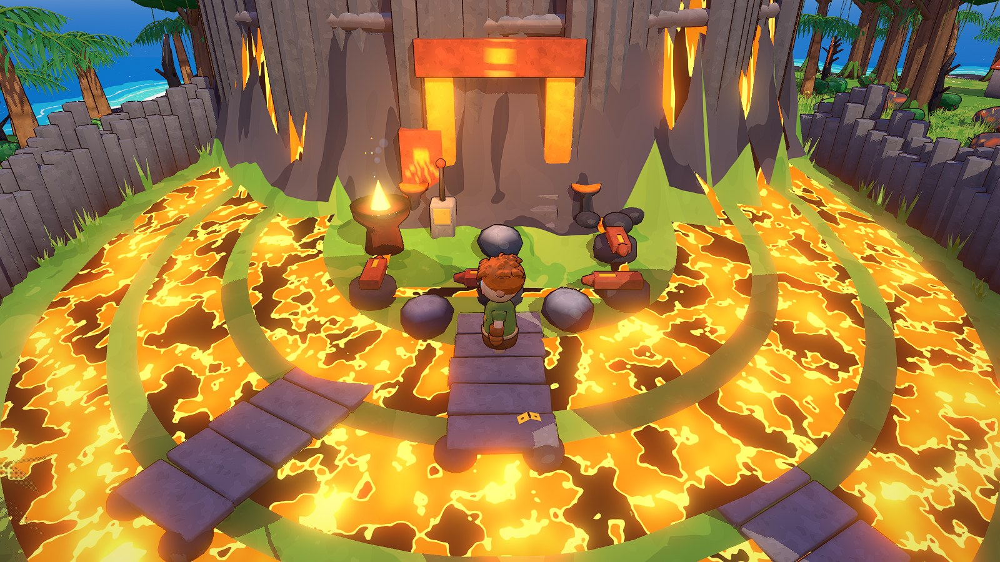
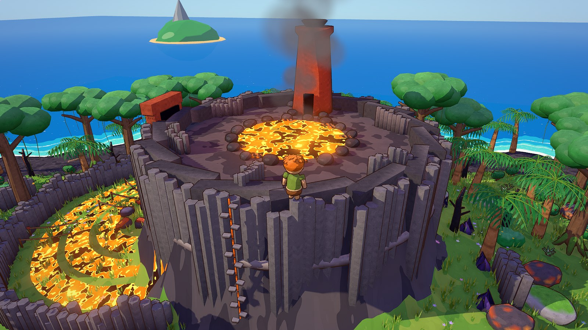
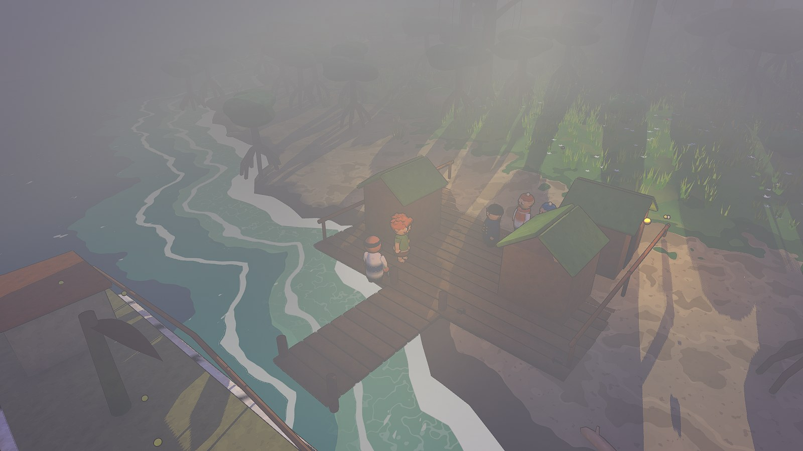
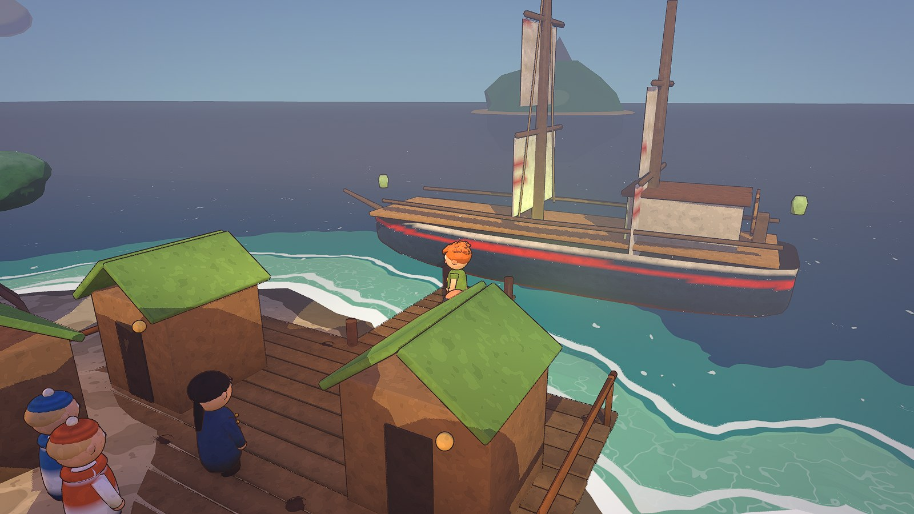
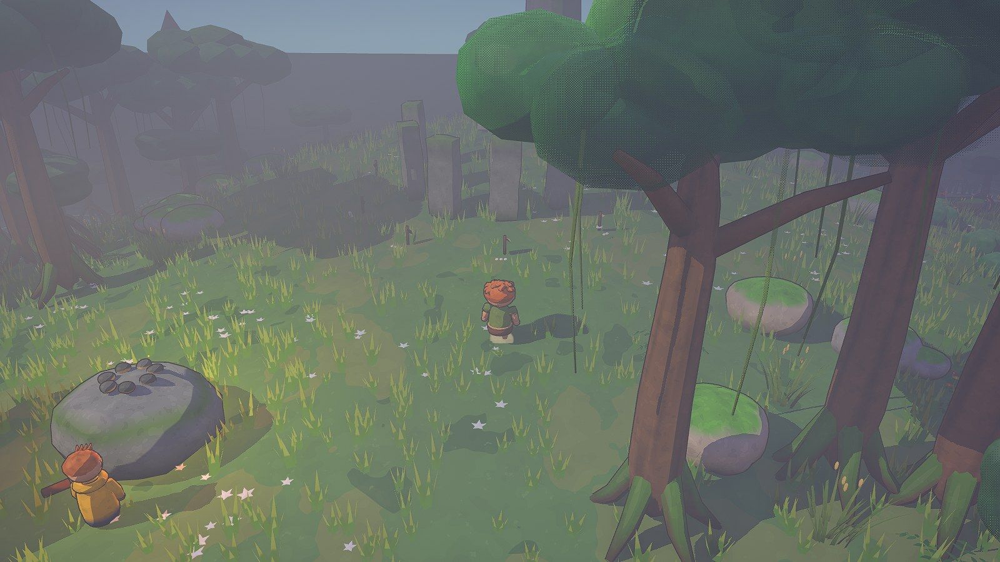
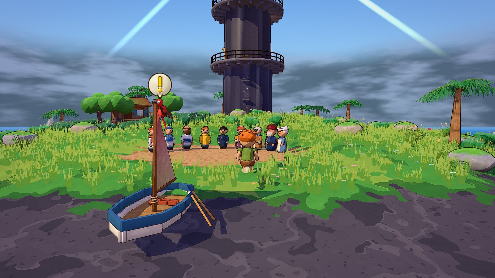
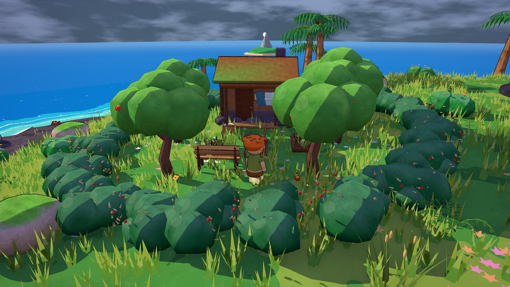
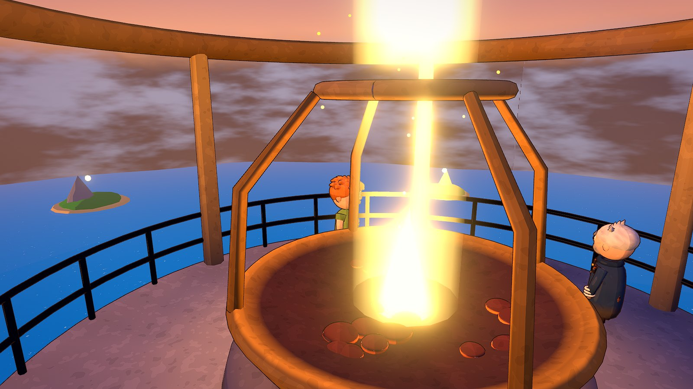

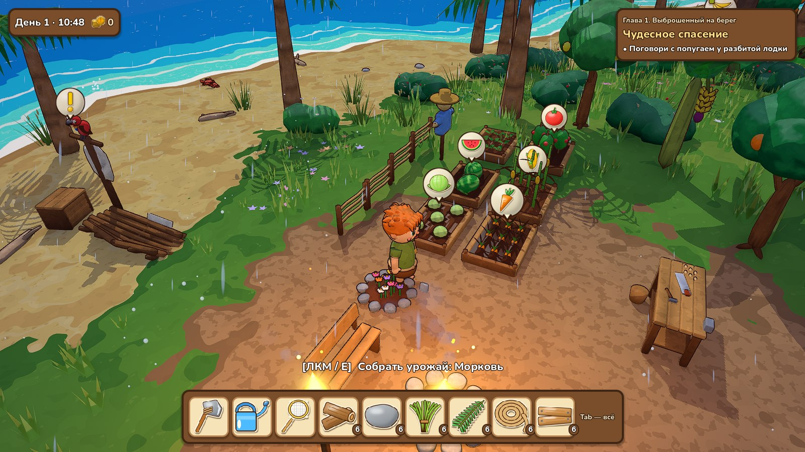
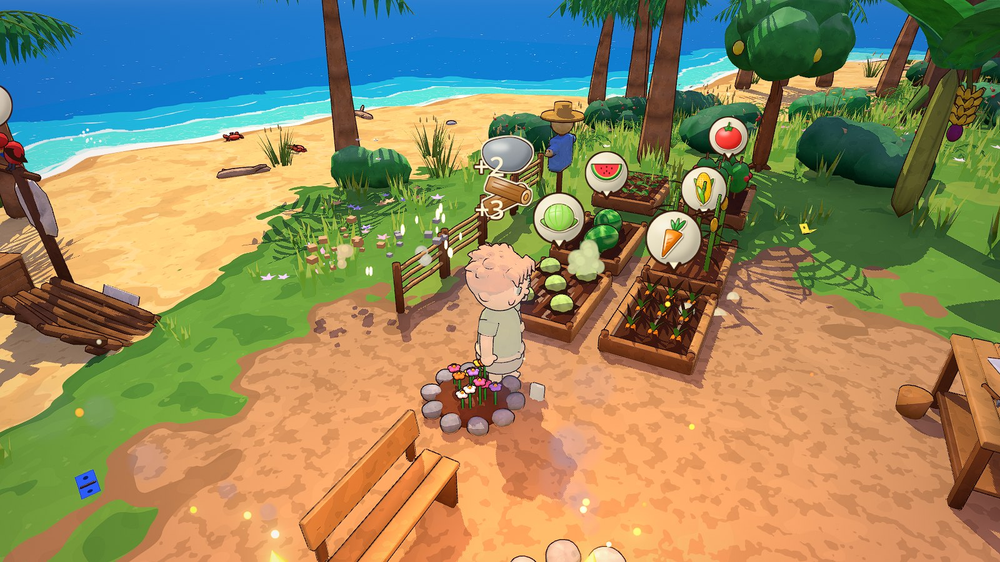


## Что нужно скачать, чтобы запустить

1. **Godot Engine 4.7** (или новее), *стандартная* версия, **не .NET**:
   https://godotengine.org/download — для Windows это один `.exe` (≈ 70 МБ), установка не нужна.
2. **Git** (чтобы скачивать обновления проекта): https://git-scm.com/downloads
   *или* просто скачай архив репозитория с GitHub (кнопка **Code → Download ZIP**).
3. *(позже, по желанию)* **Blender** для своих 3D-моделей: https://www.blender.org/download/

Требования к ПК скромные: любая видеокарта с поддержкой Vulkan (GTX 900+/RX 400+/Intel UHD 620+).
На очень старых ПК в Godot можно переключить рендерер на *Compatibility* (правый верхний угол редактора).

## Как запустить

1. Склонируй репозиторий: `git clone https://github.com/griwka/Robinzon.git`
2. Запусти Godot → **Import** → выбери файл `project.godot` в папке проекта → **Import & Edit**.
3. Первый запуск импортирует ресурсы (несколько секунд).
4. Нажми **F5** (или ▶ в правом верхнем углу) — игра запустится.

## Как собрать exe (Windows)

1. Один раз поставь шаблоны экспорта Godot той же версии: в редакторе **Editor → Manage Export Templates → Download**
   (или распакуй `Godot_v4.7.2-stable_export_templates.tpz` с GitHub-релизов Godot в
   `%APPDATA%\Godot\export_templates\4.7.2.stable`).
2. В редакторе: **Project → Export → Add… → Windows Desktop**, путь — `build/Затерянный остров.exe`,
   галочка **Embed PCK** (всё в одном файле). Или из консоли, если настройка уже есть:
   `godot --headless --path . --export-release "Windows" "build/Затерянный остров.exe"`
3. Готовый файл — в папке `build/` (≈ 140 МБ). Её можно скопировать на любой ПК с Windows и запускать без Godot.
   Сохранения лежат в `%APPDATA%\Godot\app_userdata\Затерянный остров`: пять ячеек — `save.json`, `save_2.json` … `save_5.json`.

## Звуки и лицензии

Музыка и большинство эффектов синтезированы (`tools/gen_audio.py`), в том числе все звуки событий и интерфейса.
Удары инструментов и шаги — наборы Kenney (CC0),
голоса животных — записи с Wikimedia Commons (общественное достояние, CC0, CC BY, CC BY-SA). Авторы и лицензии — в
[`assets/audio/CREDITS.md`](assets/audio/CREDITS.md).

## Управление

| Клавиша | Действие |
|---|---|
| WASD, Shift, Пробел | ходьба, бег, прыжок |
| Мышь, колёсико | камера, приближение |
| ЛКМ / E | собирать, рубить, сажать, поливать, кормить, гладить, говорить |
| C / B | крафт / строительство (ЛКМ — поставить, R — повернуть, ПКМ — отмена) |
| Пробел у лианы | лезть (W/S — вверх/вниз, Пробел — спрыгнуть) |
| 1–4 | взять инструмент из ячейки внизу (ещё раз — убрать); нужный инструмент герой берёт и сам; остальные — в сумке (Tab), клик берёт в руку |
| E у грядки или загона | круг действий: посадить, полить, удобрить / покормить, собрать, погладить (мышь, цифра или E ещё раз) |
| Q | поесть — сытость и силы (игра сама выберет подходящую еду); на морозе — чай с мёдом; у лавы — мазь от ожогов |
| клик по еде в сумке | съесть именно её |
| T | рация Тимура (после главы 4) |
| E у светлячка (с сачком) | поймать светлячка (Туманный остров) |
| E у бурлящей воды | рыбалка: закинуть, а когда клюёт — подсечь |
| Tab | инвентарь |
| J / K | журнал заданий / коллекции |
| F1 / H | справка |
| F5 / F9 | сохранить / загрузить (текущая ячейка); другие ячейки — «Загрузить игру» в меню и в паузе |
| Esc | пауза, настройки, выход в меню; «Вернуться в лагерь» — если герой где-то застрял |

Игра сама сохраняется каждые 90 секунд и при выходе.

**Полное описание игры, сюжета всех 8 глав, механик и устройства проекта — в [ОПИСАНИЕ.md](ОПИСАНИЕ.md).**
**Полный сценарий всех глав с репликами и двумя финалами — в [СЦЕНАРИЙ.md](СЦЕНАРИЙ.md).**

## Что нового в версии 1.0.7 — чёткие постройки и лодки

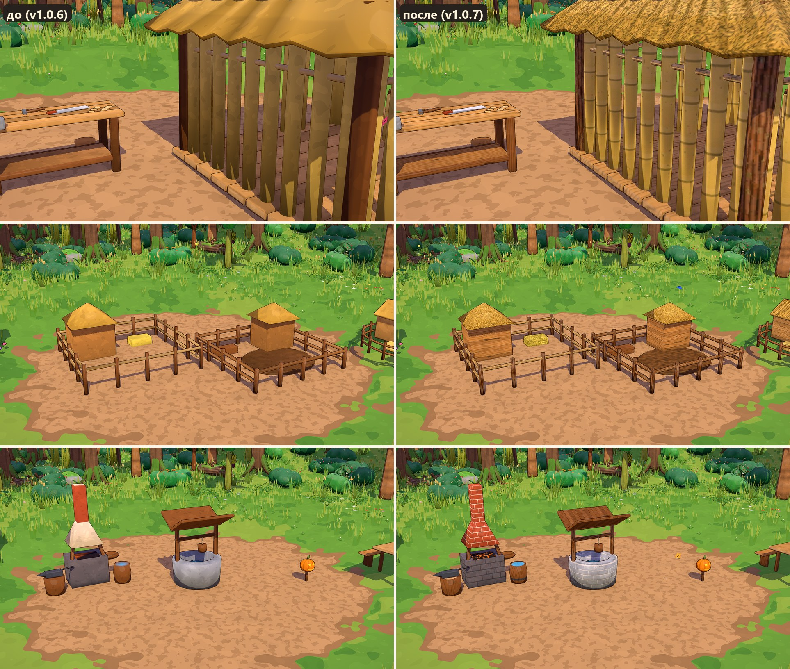

- **Все постройки и лодки — на настоящих текстурах.** Доски с волокнами и сучками, кора бороздами, солома пучками,
  камень, кирпич, черепица, металл с царапинами и ржавчиной, верёвка прядями, парусина — чётко, но по-прежнему
  уютно и без фотореализма.
- **Кладка и обшивка как настоящие:** вагонка со швами на сараях, камни со швами на колодце и горне, черепица на доме.

## Что нового в версии 1.0.6 — чёткие люди и животные

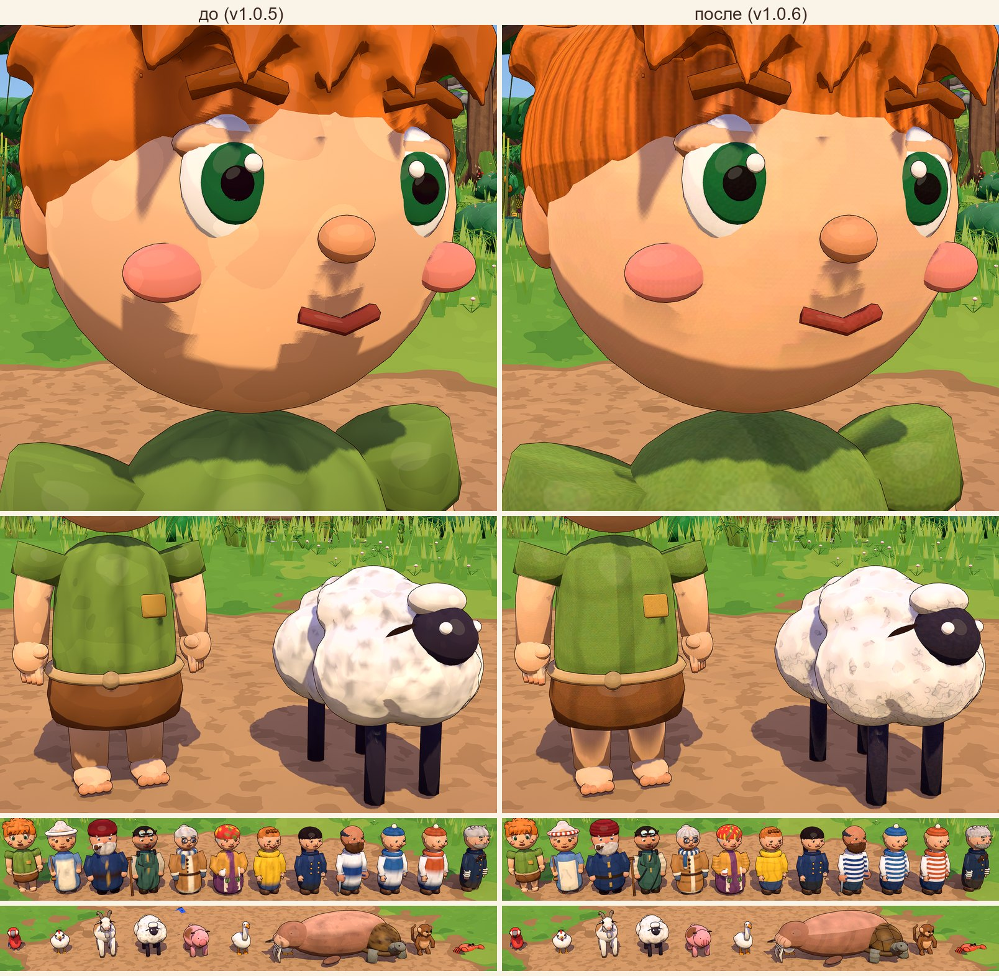

- **Люди, животные, птицы и тёплая одежда героя — на настоящих текстурах.** Раньше цвет жил в вершинах и расплывался:
  полосы тельняшек превращались в градиент, края одежды и пятна шерсти — в «мыло». Теперь раскраска запекается
  в картинку по пикселям: границы чёткие, у ткани — складки и плетение, у волос — пряди, у шерсти — штрихи,
  у руна — завитки, у птиц — ряды пёрышек.
- **Чистые лица:** крупные «мазки» фактуры больше не ложатся пятнами на кожу и одежду, тень на круглых головах
  без «ступенек».

## Что нового в версии 1.0.5 — живой остров

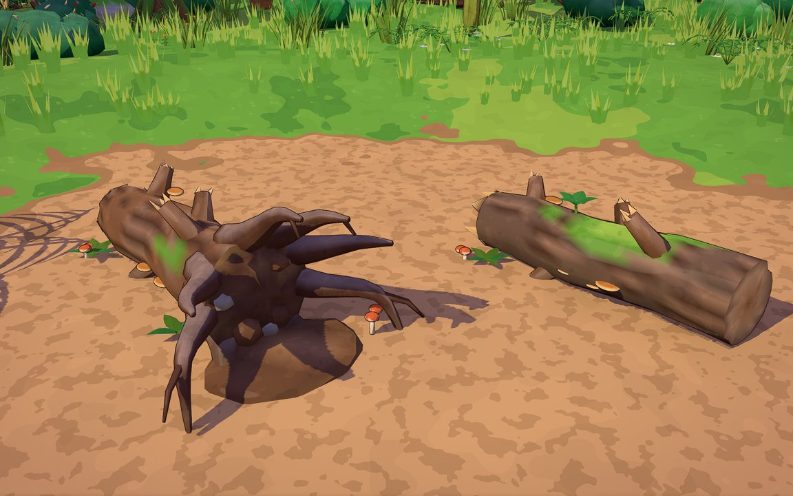
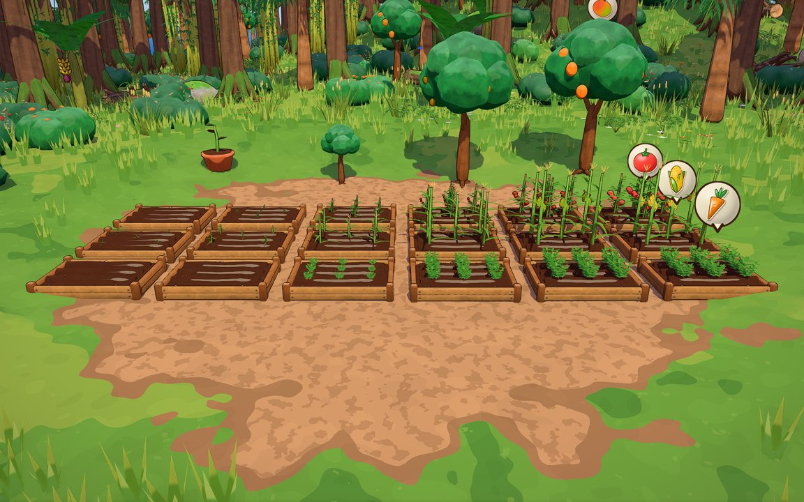
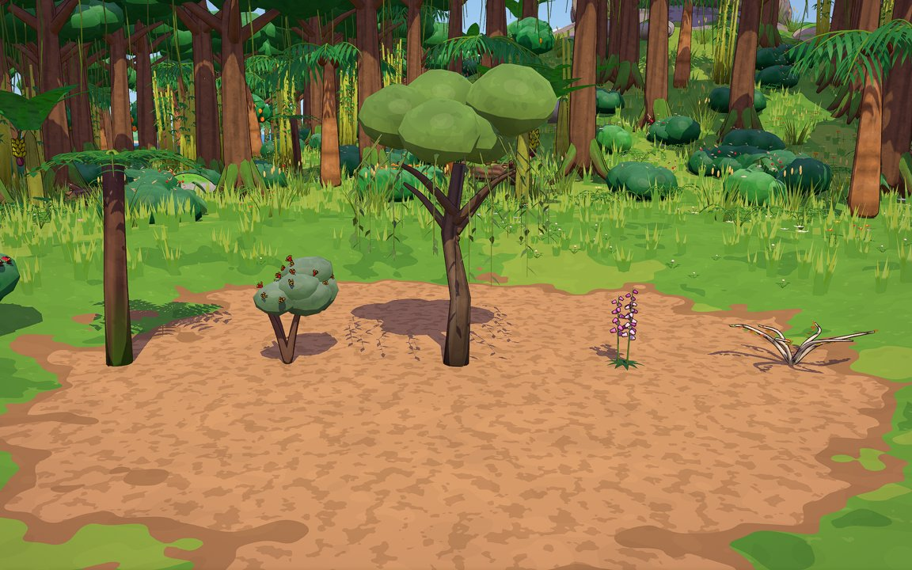
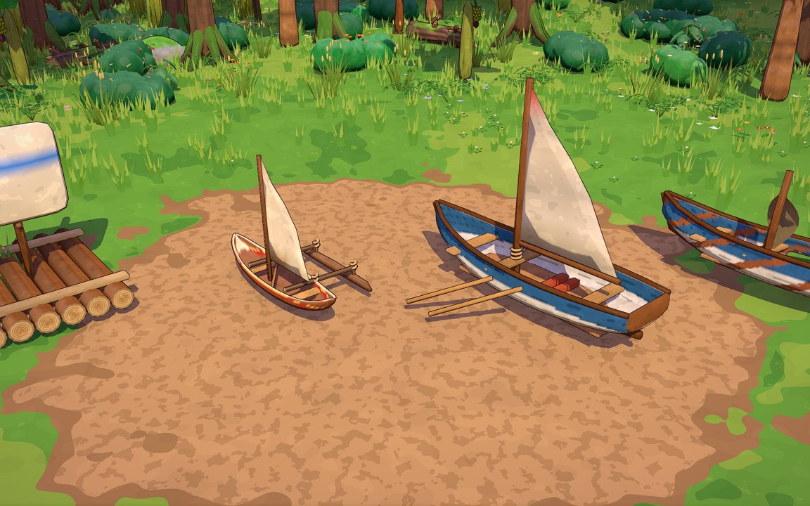
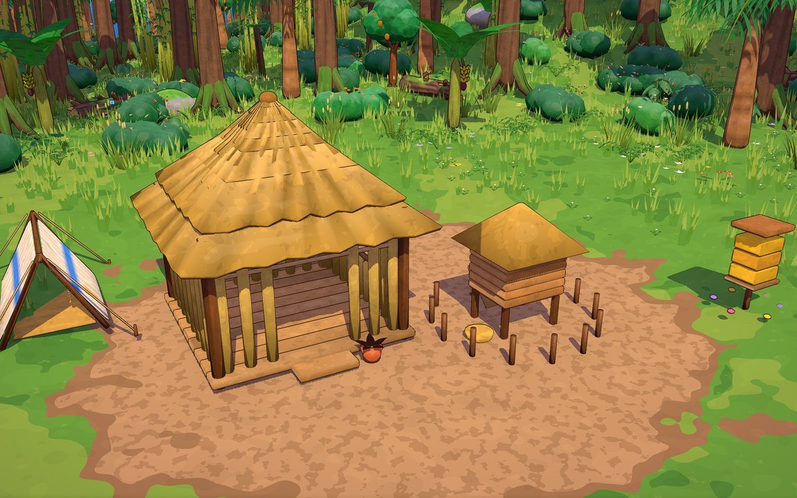
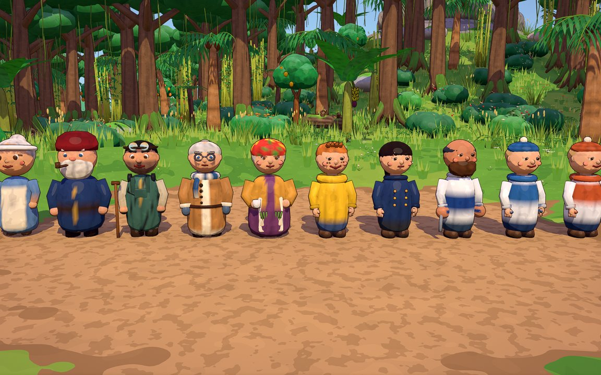
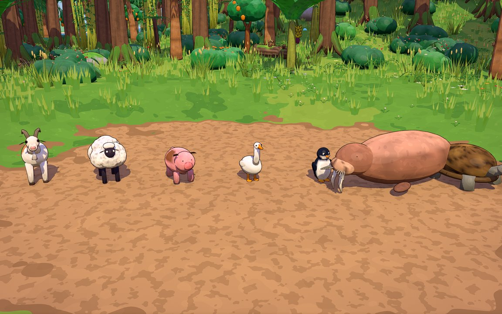
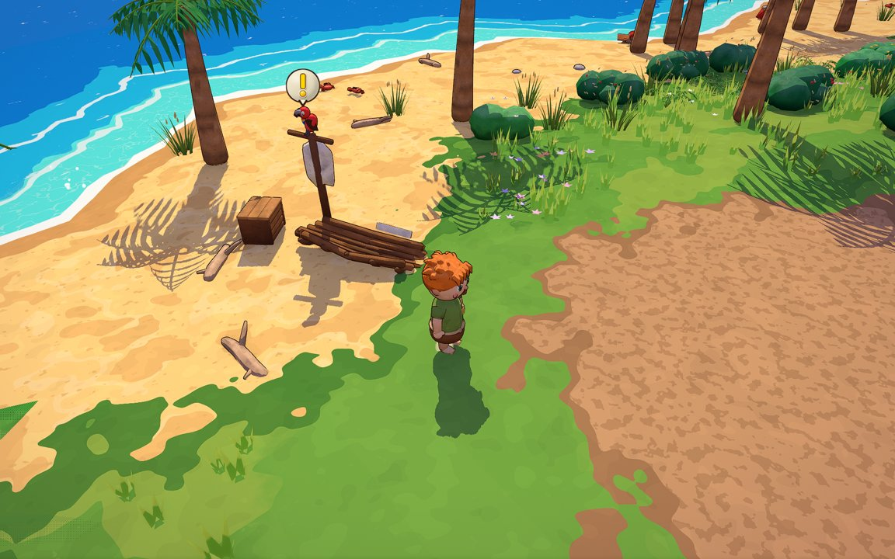

- **Расчистка мелкой травы:** ЛКМ / E у травы — вырвать (мачете — шире); расчищенное сохраняется и не зарастает,
  земля становится ровным газоном.
- **Плавный рост:** растения тянутся из ростка непрерывно, плоды наливаются и спеют — на грядках и у деревьев.
- **Новые модели:** брёвна с корнями и кольцами, 9 культур и грядка, 18 новых видов растений по островам,
  каноэ с балансиром, бот Стёпы, соломенные крыши, люди с веками и пальцами, животные со шерстью и перьями.
- **Ничего не проходит насквозь:** столкновения по самим моделям; проверка `--colcheck` на всех островах.

## Что нового в версии 1.0 — глава 8 «Око шторма» и два финала

- **10 заданий и выбор:** последний рейс (обойти всех — каждый даёт что-то на дорогу), курс на Око, сад деда,
  письма деда, Книга Хранителей, подъём на Великий маяк, встреча с Лёвой, линза, совет и выбор у Великого огня.
- **Око шторма:** маленький остров из чёрного камня в центре архипелага. Над ним чистое небо, вокруг кольцом
  кружится стена шторма, и к вершине сходятся семь лучей маяков. С высоты видны все острова.
- **Великий маяк** — последнее и самое большое лазание: по внешней стене до балкона, по лестнице внутри башни,
  и снова снаружи — к вершине. Ветер дует порывами: в порыв лучше прижаться к стене и переждать, на уступах можно
  отдышаться, на балконах ветер толкает к перилам. Тимур подбадривает по рации с каждого яруса.
- **Лёва**, сад и домик деда с насестом для Румбы, 65 писем деда, Книга Хранителей (новая коллекция из 5 страниц).
- **Тимур — по рации:** на некоторых заданиях с ним говорят клавишей T.
- **Праздничный стол** (по желанию): обед из лавки Марты за 60 монет — сцена со всеми жителями перед выбором.
- **Два финала** без «правильного»: «Открытое море» (огонь гаснет, шторм растворяется) и «Хранитель огня»
  (ты встаёшь к огню вместо брата). Эпилог, титры с портретами всех жителей, отметка о финале в главном меню
  (сохраняется и после новой игры — можно пройти иначе).
- **После финала — вечная игра:** доска заказов у лагеря (три новых заказа каждое утро, платят больше лавки),
  торговое судно Лёвы с саженцами и животными. «Открытое море» — урожай дороже (пришли торговые корабли);
  «Хранитель огня» — у Великого огня можно «зажечь лучи» (день щедрости: урожай вдвое) и открыть окно в шторме
  (корабль Лёвы у причала дома).
- **Музыка:** свои темы для Ока (подъём), встречи с братом и двух финалов; звуки порыва ветра и угасающего огня.
- 14 новых моделей (Лёва, домик деда, насест, яблоня, скамейка, грядка, ящик писем, Книга на каменном столе,
  Великий маяк, выступы и уступы, чаша Великого огня, стена шторма, доска заказов), 10 иконок.
- Автотест главы 8 проходит её целиком с финалом «Открытое море» и отдельно — выбор «Хранителя огня».

## Версия 0.11 — глава 7 «Туманный остров»

- **16 заданий:** пеленгатор, ночной курс в туман, светлячки, тыквенные фонари на тропе, юнга Миша, лагерь на сваях,
  «Альбатрос» в тихой воде, еда и аптечки для выживших, корпус, боцман Стёпа плывёт к своим, мачта и паруса,
  тени на скалах, Потерянный маяк, деревня у маяка на твоём острове, руль и огни, выход «Альбатроса» из лагуны.
- **Туман:** остров окутан объёмным туманом, видно на несколько шагов. Туман расступается у огня: костёр,
  фонарь, фонарь со светлячками (самый большой круг), тыквенные фонари на метках — те разгоняют туман навсегда.
  Плыть туда можно только ночью (с 20:00 до 4:00); днём у причала можно дождаться ночи.
- **Выжившие:** Миша, Рената, Гоша, близнецы Петя и Паша. Монет у них нет — за помощь они отдают письма домой
  (новая коллекция «Письма команды»).
- **«Альбатрос»** чинится по частям: корпус, мачта с парусами, руль, огни, рация — корабль меняется на глазах.
  Его собирает весь архипелаг: гвозди, масло, канаты, радиолампы, аптечки, карта из всех лавок.
- **Тени на скалах:** три тыквенных фонаря у стоячих камней — на нужных метках тени складываются в знак Ока.
  Фонарь у камней можно забрать и переставить.
- **Пассажир:** Стёпу забирают из форта и привозят ночью; он остаётся с командой.
- **Деревня:** четыре дома, колодец и длинный стол на острове крушения — выжившие переезжают туда, Миша становится
  паромщиком (паром на любой открытый остров).
- **Новое:** пеленгатор, светлячки и ночные мотыльки (коллекция), воск из улья, свечи, тыквенные фонари, мангры
  и мангровые доски, корабельный канат и парус, аптечка, морская карта; 26 новых моделей, 28 иконок,
  звуки лягушек, скрипа корабля, паруса и праздника.
- Автотест главы 7 (три части: Туманный — дом — Туманный) проверяет туман, светлячков, метки, тени и выход корабля.

## Версия 0.10 — глава 6 «Остров Вулкана»

- **14 заданий:** чёрный песок и горячие источники, доктор Вера, мазь от ожогов, черепахи Веры, кофе и перец,
  руда и уголь, кузница, железная кирка, переход через лаву, Огненный монолит, Храм Хранителей,
  обсидиановая линза, Огонь кратера, разговор с Верой о брате.
- **Жар** — зеркало холода: у лавы растёт шкала жара. Огнеупорные рукавицы — вдвое медленнее, мазь от ожогов (Q) —
  ещё медленнее целую минуту, горячие источники остужают сразу. Полная шкала никого не обжигает: жар отбрасывает от лавы.
- **Кузница:** железо из руды и угля, железная кирка (ломает базальт и обсидиан), железные гвозди, линза в тигле.
- **Лавовое поле:** три огненных ручья перед храмом, мостки из камня — только на местах с колышками.
- **Огненный монолит:** четыре каменных жёлоба надо повернуть так, чтобы лава из трещины дошла до чаши. Неверно —
  лава застывает у того жёлоба, что смотрит не туда.
- **Кратер:** подъём по горячей стене из базальтовых столбов, наверху — озеро лавы, дым и маяк Огонь кратера.
- **Ферма:** загон черепах (корм — тыква) даёт удобрение — грядка с ним растёт вдвое быстрее; новая культура — перец;
  дикий кофе на склонах.
- **Новое:** лавка «Источники», алоэ, мазь, уголь, руда, слиток, обсидиан, линза, тигель, жареный кофе, острая похлёбка,
  травяной сбор, огнеупорные рукавицы (видны на герое); коллекции «Камни вулкана» и «Записи с Вулкана»;
  31 новая модель, 32 иконки, звуки лавы, пара, молота, черепах и гула вулкана.
- Автотест главы 6 проверяет жар, лаву, мостки, источники и головоломку и проходит главу целиком.

## Версия 0.9 — глава 5 «Ледяной остров»

- **14 заданий:** тёплая одежда, высадка на лёд, ледоруб, морж на тропе, подъём по ледяной стене, штурман Ингрид,
  голодные пингвины, печка и чай, теплица с морошкой, три ледяных ларца, секстант, звёздный круг, Холодное сердце, оттепель.
- **Холод:** вдали от огня тает шкала тепла. Свитер греет вдвое лучше, чем ничего, пуховая куртка — втрое,
  валенки с рукавицами — ещё лучше. Греют костёр, печка, палатка, теплица, жаровня, дверь обсерватории; кружка чая
  с мёдом (Q) — две минуты без холода. Замёрз — идёшь медленно, не лазаешь, инструменты не держатся;
  через полминуты Румба утащит к ближайшему огню. Ничего не теряется. Тёплая одежда видна на герое.
- **Ледник** с отвесным обрывом в 7 м: наверх — по ледяной стене с зарубками (ледоруб и перчатки), на зарубках можно
  отдышаться. Внизу у стены спит морж — без пяти рыб не уйдёт.
- **Подлёдная рыбалка:** ледовым буром сверлишь лунку на припае у пингвинов, рыба там северная (новая коллекция).
- **Теплица:** четыре грядки под стеклом — растут и в мороз, и на четверть быстрее. В тундре растёт морошка.
- **Звёздный круг** у телескопа: ночью повернуть три кольца по подсказкам из листов Лёвы.
- **Оттепель:** когда загорается Холодное сердце, снег сходит, тундра зеленеет и цветёт, холод уходит.
- **Новое:** лавка «Штурманская», ледоруб, ледовый бур, лёд, смола, мороженое, чай с мёдом, морошка и варенье,
  брусника, валенки и рукавицы, печка, теплица; коллекции «Северные рыбы» и «Звёздные карты»;
  42 новые модели, 26 иконок, звуки ветра, льда, пингвинов, храпа моржа, капели и скрипа снега.
- Автотест главы 5 проходит её целиком и проверяет холод, спасение у огня, лунки, теплицу и звёздный круг.

## Версия 0.8 — глава 4 «Грозовой остров»

- **14 заданий:** бот боцмана Стёпы, высадка в грозу, радист Тимур, громоотвод, гуси, тыквы под дождём,
  стекло из песка, бункер метеостанции, журнал 1958 года, радиостанция, запись Лёвы, Башня громов, рация.
- **Гроза по расписанию:** вечные тучи, каждые 4–5 минут — гроза с ливнем, громом и молниями.
  Ливень сам поливает грядки, громоотвод заряжает аккумуляторы (их покупает Тимур), по лианам в грозу не лазают,
  на открытой вершине молния отбросит и выбьет пару вещей из сумки (их можно подобрать). Под навесом — безопасно.
  После грозы выглядывает солнце, а там, куда била молния, лежат «стекляшки» для новой коллекции.
- **Бункер на 7 ярусов** под станцией: генератор зажигает лампы на трёх верхних ярусах, ниже — только с фонарём.
  Спуск — прыжком в проём перил, подъём — по железным лестницам.
- **Новое:** лавка «Радиорубка», гуси и перья, тыква и тыквенная каша, черника, песок, стекло, медная проволока,
  фонарь, аккумуляторы, рецепты свитера и пуховой куртки; около 40 моделей и 30 иконок, звуки грома, рации и гусей.
- Автотест главы 4 проходит её целиком; валидатор проверяет и ярусы бункера (свет генератора или фонарь).

## Версия 0.7.1 — графика

Полный разбор — в [docs/ГРАФИКА.md](docs/ГРАФИКА.md).
- **Свет и тени:**
  - тени без ряби (фильтрация PCF), солнце идёт дугой и не встаёт в зенит — тени и объём есть весь день;
  - тени заливает рисованное небо: сверху сиреневым, снизу тёплым светом;
  - мягкое затенение в углах (SSAO), дымка вдали;
  - свечение огня, искр, солнца и светлячков.
- **Новое небо:** ореол и диск солнца, закатная полоса, звёзды и луна-серп; облака окрашиваются в цвет неба.
- **Чёткость:**
  - адаптивная резкость без ореолов вокруг контуров;
  - границы цветов на земле и воде сглажены;
  - текстуры с mip-уровнями, анизотропия 16x.
- **Земля, трава, вода:**
  - песок с рябью, бирюзовое дно;
  - трава в цвет газона, приминается под ногами;
  - каустика и солнечная дорожка на воде.
- **Листва** расступается перед героем, а не закрывает полэкрана.
- **Эффекты:**
  - щепки, искры, листья, «пуф», кольцо пыли от упавшего дерева;
  - пыль из-под ног, брызги;
  - дым и угольки над огнём, пылинки днём, тёплый дождь, значки «+N» над головой.
- **Отклик:**
  - тряска камеры (выключается в настройках), стоп-кадр и белая вспышка при ударе;
  - дерево падает от игрока;
  - на бегу кадр чуть раскрывается;
  - реплики печатаются, окна появляются мягко.
- **Настройка «Эффекты»** (низко/средне/высоко) для слабых ПК.

## Что есть в версии 0.7

- **Глава 3 «Старый форт» (12 заданий):** боцман Стёпа, рыбалка с подсечкой, поросёнок роет трюфели,
  глина, печь и кирпичи, ворота форта на ключ, затопленный подвал с головоломкой из трёх рычагов,
  древние рисунки на стенах (тайна маяков), огонь в башне форта открывает путь к Грозовому острову.
- Новые модели: стены и ворота форта, караулка, рычаги, хижина и сам Стёпа, свинья, свинарник, печь, глиняная яма,
  удочка и лопата; новые иконки рыб, рисунки на стенах.

## Версия 0.6

- **Глава 2 целиком (13 заданий):** после чаши огня — лавка Марты, пасека, обезьянка Кешью с ключом,
  отстройка дома Лёвы на дереве и его сундук, овцы и шерсть, каноэ к Старому форту.
- **Экономика на монетах:** урожай и продукты фермы продаются Румбе и Марте; за монеты покупаются гвозди,
  рамка улья, овца — то, без чего сюжет не идёт дальше. Семена в лавке есть всегда.
- **Защита от тупиков:** что сделано заранее — засчитывается; еда для задания не съедается и не продаётся;
  валидатор проверяет выполнимость всех заданий и хватает ли страниц журнала.
- **Чёткая картинка:** контуры в пикселях, резкие тени, рисованная фактура, настройка «Чёткость картинки».

## Версия 0.5

- **Два острова и плавание.** Плот у кромки воды открывает выбор острова. У каждого острова свои постройки
  и своя расчистка; всё сохраняется.
- **Глава 2 — остров Великого Баньяна (пролог, 7 заданий).** В центре — исполинское дерево ~30 м
  с тремя ярусами. К корням прорубаешься через завесы лиан, плетёшь перчатки лазальщика и поднимаешься по лианам.
  На втором ярусе живёт Марта, повар «Альбатроса», — она поддерживает огонь и знает, куда ушёл Лёва.
- **Лазание в духе PEAK:** Пробел у лианы — лезть, W/S — вверх/вниз, Пробел — спрыгнуть. Подъём тратит силы
  (жёлтая полоска), на земле они восстанавливаются, а еда (Q) возвращает их прямо на лиане.

## Версия 0.4

- **Остров зарос.** Свободна только полянка у места крушения. Дальше — джунгли: трава и папоротник (руками),
  колючий кустарник и бамбук (мачете), деревья-гиганты и поваленные стволы (топор), валуны и каменные гряды (кирка).
  Расчищенное остаётся расчищенным навсегда (сохраняется).
- **Сюжетные места в глубине острова:** заросший лагерь Лёвы на западе, шлюпка «Альбатроса» за скалами на севере,
  древний маяк из чёрного камня на вершине. Добраться можно только с нужными инструментами.
- **Сюжет главы 1 (22 задания):** поиски брата Лёвы. Финал — зажечь древний маяк, и с соседнего острова отвечает огонь.
- **3D-модели из Blender:** герой, попугай Румба, курица, коза, краб; 3 вида пальм, банановое, манговое и лимонное
  деревья, деревья-гиганты, бамбук, папоротники, кусты, цветы, камни и гряды; все постройки, грядки и 6 культур;
  инструменты в руке. Всего ~65 моделей, все строятся скриптами (`tools/blender/`).
- **Иконки, звук, меню** — как в 0.3: рисованные иконки в стиле оригинала, синтезированные музыка и звуки, меню и настройки.
- **Ферма и хозяйство:** грядки с поливом, фруктовые деревья, курятник и коза, бабочки, коллекции, декор. Энергии нет.

Полный план игры на 8 глав — в [docs/DESIGN.md](docs/DESIGN.md).

## Структура проекта

```
project.godot          настройки проекта
scenes/main.tscn       главная сцена (всё остальное создаётся из кода)
scripts/
  data.gd              ВЕСЬ КОНТЕНТ: предметы, рецепты, постройки, грядки, животные, коллекции, задания
  game.gd              состояние игры: инвентарь, задания, открытия, время, сохранения
  main.gd              сборка мира, небо и день/ночь, связь систем
  garden_bed.gd        грядка;  fruit_tree.gd — деревья;  animal_pen.gd / animal.gd — животные
  npc.gd               попугай Румба;  supply_crate.gd — ящик с корабля;  critters.gd — бабочки, крабы, светлячки
  island.gd            генерация острова, воды, травы и расстановка ресурсов
  grass_field.gd       мелкая трава, цветы и клевер: расчистка и сохранение расчищенного
  player.gd            персонаж, камера, анимация, взаимодействие
  resource_node.gd     добываемые ресурсы
  building.gd          постройки и их действия
  build_system.gd      режим строительства
  hud.gd               интерфейс
  models.gd            процедурные low-poly модели (временная графика)
  dev_tools.gd         скриншоты и автотест для разработки
  audio.gd             музыка, атмосфера, эффекты (autoload Audio)
  menu.gd              главное меню, пауза, настройки
assets/                иконки, звуки, шрифт Nunito (OFL)
tools/                 генераторы иконок и звуков (Python)
tools/blender/         все 3D-модели игры (Blender как Python-модуль bpy)
shaders/               toon, земля, контур, вода, трава, крылья бабочек
docs/DESIGN.md         дизайн-документ и план развития
```

**Контент и баланс правятся в `scripts/data.gd`**: там все предметы, рецепты, постройки, культуры, задания и диалоги.

## Для разработки

Проверка сюжета и автотесты всех глав (с торговлей, лазанием и сценариями ошибок игрока):

```
godot --headless --path . -- --validate
godot --headless --path . -- --autotest
godot --headless --path . -- --autotest --location=banyan --chapter=2
godot --headless --path . -- --autotest --location=fort --chapter=3
godot --headless --path . -- --autotest --location=fort --chapter=4 --upto=1
godot --headless --path . -- --autotest --location=storm --chapter=4 --from=1
godot --headless --path . -- --autotest --location=storm --chapter=5 --upto=1
godot --headless --path . -- --autotest --location=ice --chapter=5 --from=1
godot --headless --path . -- --autotest --location=volcano --chapter=6
godot --headless --path . -- --autotest --location=fog --chapter=7 --upto=13
godot --headless --path . -- --autotest --location=home --chapter=7 --from=13 --upto=1
godot --headless --path . -- --autotest --location=fog --chapter=7 --from=14
```

Проверка, что у видимых моделей есть столкновения (на каждом острове):
`godot --headless --path . -- --colcheck --location=storm`

Пересобрать модели (нужен Python 3.13 и `pip install bpy`): `python tools/blender/build.py`

Скриншот с демо-лагерем: `godot --path . -- --shot=shot.png --time=0.42 --demo --frames=150`
