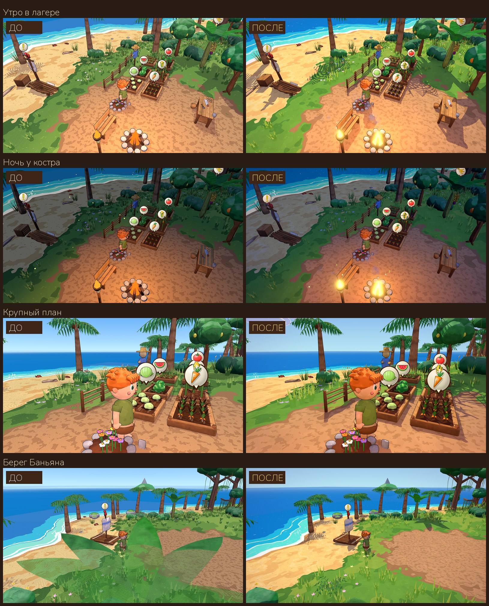
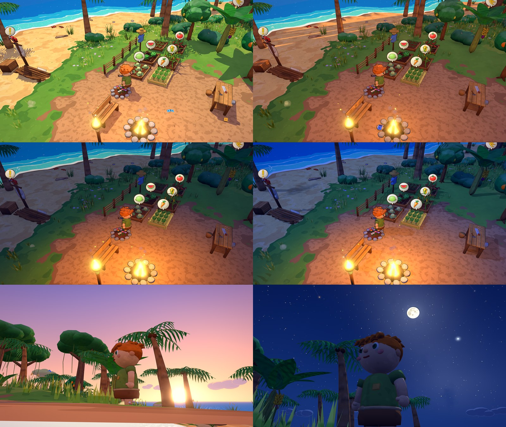
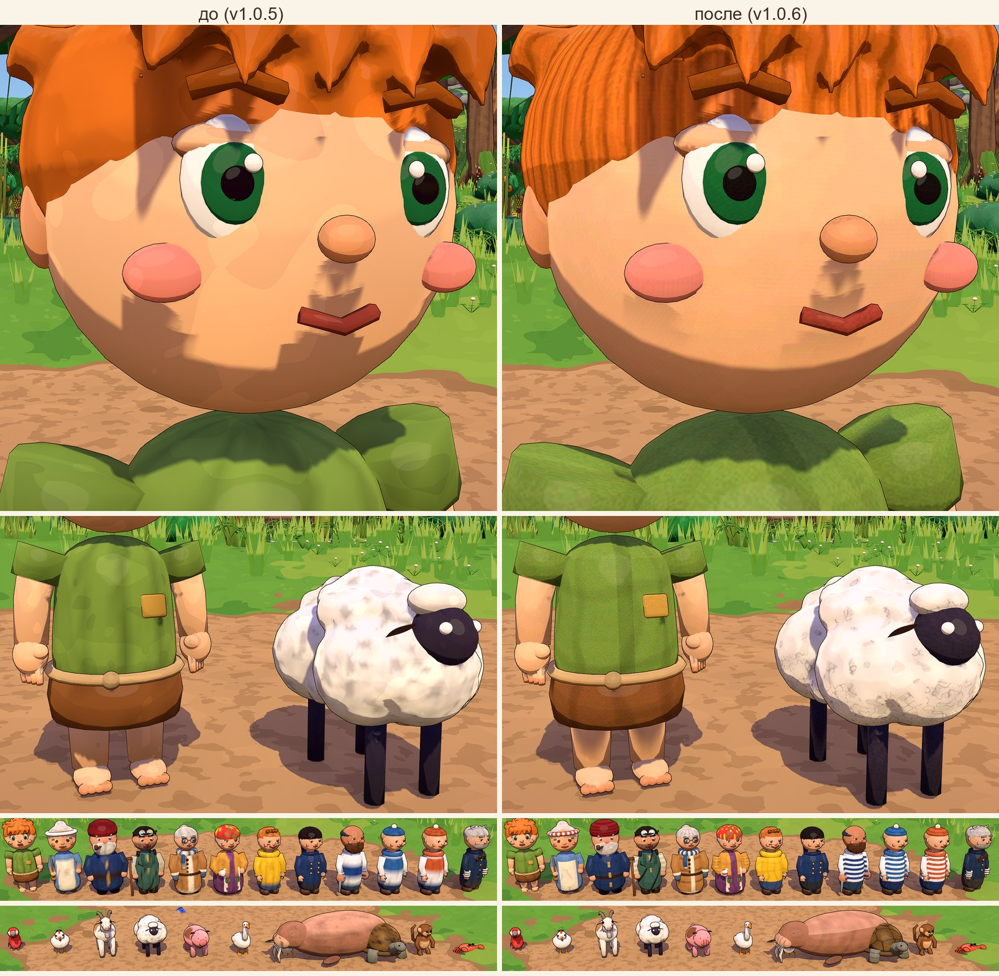
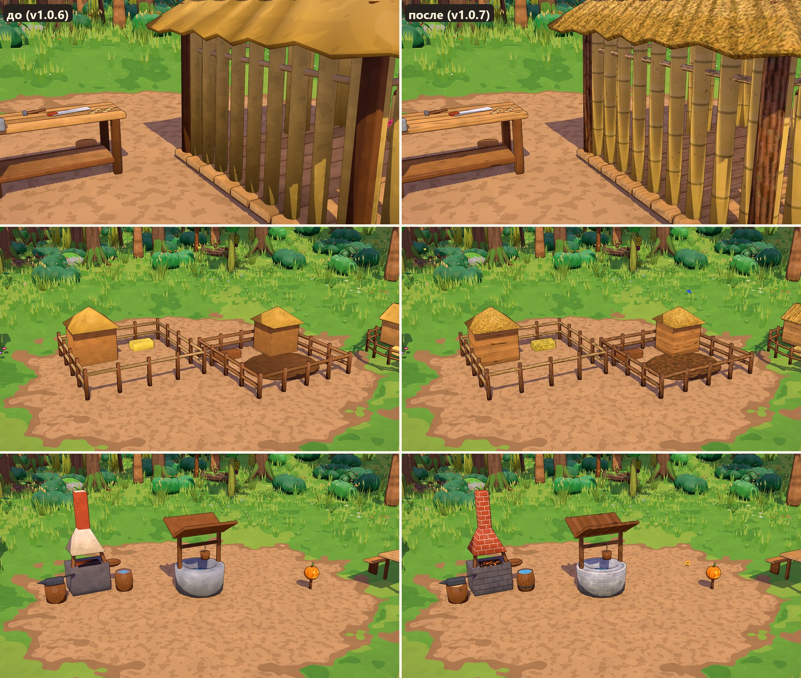
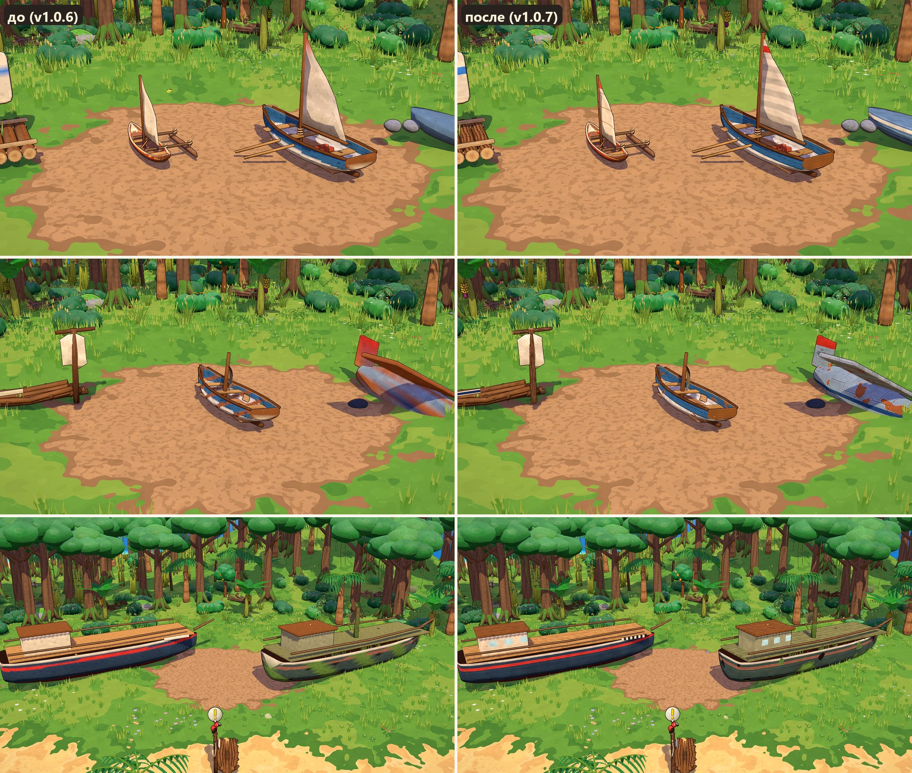
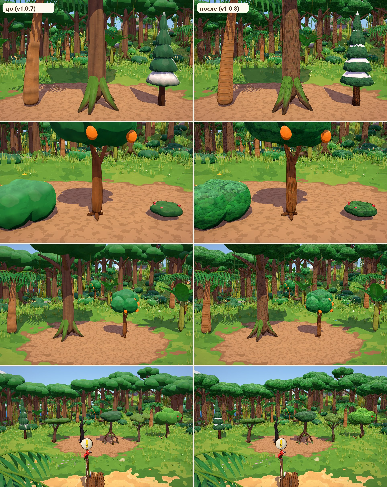
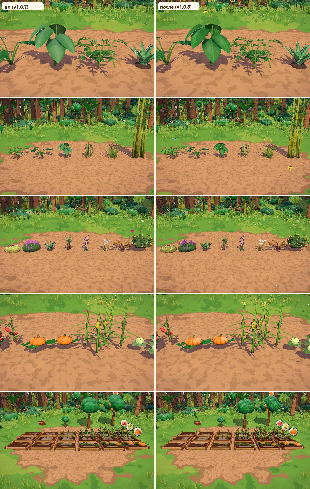
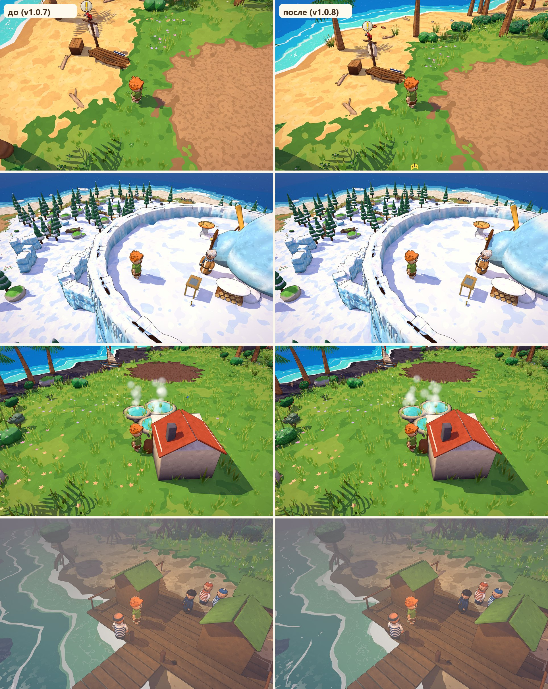

# Графика «Затерянного острова»: как устроена картинка

Документ для разработки: что портило картинку и что исправлено, как устроены свет, небо, материалы, эффекты
и отклик управления, и где их настраивать.



## 1. Что сильнее всего портило картинку (аудит, по убыванию вреда)

1. **«Теневые прыщи» (shadow acne).** Вся земля была покрыта мелкой рябью из точек дугами.
   Причина: тени без фильтрации (PCF выключен) — жёсткое сравнение глубины на пологом рельефе.
   Фильтр резкости делал рябь ещё заметнее.
2. **Плоский свет.** Тени заливались ровным сиреневым светом без направления: у теневой стороны не было формы.
   Солнце в полдень стояло в зените, тени были короткими, а предметы «висели» над землёй без контактной тени.
3. **Сетка точек в листве у камеры.** Листья ближе 5 м к камере «просеивались» точечной решёткой.
   На Баньяне большие листья превращались в сито на треть экрана.
4. **Грубое повышение резкости.** Простая маска нерезкости с силой ×1 давала светлые ореолы вокруг контуров
   и усиливала «лесенку» и шум.
5. **Огонь без свечения.** Костры и факелы были плоскими оранжевыми конусами: ночью не светились, без дыма и искр.
6. **Бледное стандартное небо.** Не было солнца, звёзд и луны. Облака — серые шары, освещённые как земля.
7. **Ступенчатые границы цветов на земле и в воде.** Функция `step` без сглаживания давала зубцы,
   которые мерцали при движении камеры.
8. **Текстуры без mip-уровней.** Фактура мазков (`painted.png`) рябила вдали, значки над грядками и в интерфейсе
   «хрустели». Анизотропная фильтрация была всего 2x.
9. **Тёмные основания пучков травы.** По всему газону шли тёмные крапинки: трава не совпадала по цвету с землёй.
10. **Ободок светился в темноте.** Светлый край силуэта был эмиссией: ночью все предметы светились по краю,
    и ступенька была без сглаживания.
11. **Двойная граница тени на персонажах.** Заполняющий свет рисовался тем же жёстким мультяшным порогом,
    что и солнце.
12. **Частицы-кубики.** Без уменьшения и затухания, исчезали разом. Не было пыли от шагов и приземления,
    брызг и дыма.
13. **Слабый отклик ударов.** Было только покачивание: ни вспышки, ни тряски, ни стоп-кадра.
    Срубленное дерево никуда не падало, а пыль удалялась вместе с объектом.
14. **Не было погоды и «воздуха».** Мир выглядел стерильным.
15. **Невидимые разовые эффекты.** Частицы ударов (щепки, пыль) запускались до того, как им назначали сетку
    и параметры, — в этом случае Godot их не рисует. Щепки при ударах не были видны никогда.
    Исправлено: излучение включается после полной настройки (`restart` через `call_deferred`).
16. **Скрытая ошибка — «горящие» пиксели (NaN).** Шейдер контура читал цвет вершин, а у части сеток его нет.
    Там оказывался мусор. Без свечения это были незаметные тёмные точки, а со свечением — белые пятна.
    Исправлено: контур больше не читает цвет вершин. Для надёжности toon-шейдер тоже защищён от вырожденных
    нормалей и мусора в цвете, а дробные степени от нуля убраны из всех шейдеров.

## 2. Свет, тени и окружение — `scripts/world_env.gd`

Всё, что отвечает за освещение, — в одном узле `WorldEnv`. Цвета берутся из `scripts/palette.gd`.

| Что | Как сейчас | Зачем |
|---|---|---|
| Солнце | настоящая дуга небесной сферы (широта ~32°): встаёт на востоке, в полдень **на 58°**, садится на западе; цвет и сила — по палитре суток, у горизонта гаснет плавно | тени и объём есть даже в полдень, закатные тени длинные |
| Тени | 2 ступени до 70 м, первая — 15 м вокруг камеры, плавный шов, PCF (мягкий низкий) + `shadow_blur 0.6` | нет «прыщей»; край гладкий, а резкий порог в шейдере оставляет его чётким |
| Заливка теней | из неба (`AMBIENT_SOURCE_SKY`): сверху сиреневато-голубая, снизу тёплая — отражённый от песка свет | форма читается и в тени; тени уютные, а не серые |
| Заполняющий свет | убран | давал вторую жёсткую границу тени |
| SSAO | радиус 1.1, сила 1.6, слегка влияет и на прямой свет | камни, ящики, грядки «стоят» на земле |
| Свечение (glow) | только у того, что ярче белого (порог 1.15): огонь, искры, солнце, светлячки; ночью сильнее | огонь светится, а день остаётся чётким |
| Дымка | по глубине 30–360 м, цвет горизонта, плотность по времени суток | дальние острова уходят в воздух — появляется глубина |
| Тонмаппинг | линейный, экспозиция 1 | цвета палитры выводятся как нарисованы; ярче белого — только источники света |
| Луна | та же лампа `Sun`: в сумерках, когда солнце уже не светит, она переходит к луне (энергия в этот миг 0 — без скачка); голубой свет до 0.25 с мягкими тенями, сила по фазе | ночь синяя, видны лунные тени |
| Огни | общий параметр `g_lamp`: днём 0.55, в сумерках и ночью (и в грозу, в тумане) — 1.4; в хижинах и палатках ночью загорается свой огонёк | днём костёр не «прожектор», ночью — тёплый круг света |

**Сознательно выключено:**
- **SSR** (отражения в экранном пространстве): в мультяшном стиле нет зеркальных поверхностей, а вода рисуется
  своим шейдером. SSR дал бы только шум и потерю кадров.
- **SDFGI / VoxelGI** (глобальное освещение): тяжёлые, на процедурном острове «протекают» светом и спорят
  с нарисованной палитрой теней. Мягкую заливку даёт небо, контакт с землёй — SSAO.

**Качество** (меню «Настройки»):
- «Эффекты»: низко — без свечения и SSAO; средне — SSAO попроще; высоко — всё.
- «Тени»: размер карты теней и качество фильтра.
- «Сглаживание»: MSAA 2x/4x.
- «Чёткость картинки»: сила адаптивной резкости.
- «Тряска камеры»: можно выключить.

## 3. Сутки и небо — `scripts/world_env.gd`, `scripts/palette.gd`, `shaders/sky.gdshader`, `scripts/sky_stars.gd`



**Сутки идут непрерывно.** Палитра (`Palette.at_elevation(высота солнца, вечер)`) плавно смешивает ключевые точки:
день → золотой час → закат (утром — розовый, дымчатый рассвет) → синие сумерки → поздние сумерки → ночь.
Солнце, луна и звёзды движутся каждый кадр — без рывков. Ночь идёт вдвое быстрее дня, но разгон плавный
(`Game._process`), музыка ночи вступает вместе с сумерками (`WorldEnv.night_amount()` в `audio.gd`).

**Небесная сфера.** Остров стоит на широте ~32° северного полушария: Полярная звезда невысоко на севере,
вокруг неё кружат Большая Медведица, Малая Медведица и Кассиопея; в полночь на юге — Орион с Сириусом,
Плеяды, Альдебаран, Близнецы; вечером на западе — Лебедь, Вега и Альтаир, под утро встают Лев и Арктур.
Вечерняя звезда (Венера) загорается первой недалеко от закатившегося солнца. Звёзды взяты настоящие
(`SkyStars.STARS`: прямое восхождение, склонение, звёздная величина), линии созвездий — еле заметные.

**Луна** — шар, освещённый настоящим солнцем: фаза и наклон серпа получаются сами, моря на своих местах,
тёмная часть чуть видна (пепельный свет). Фаза меняется день ото дня (`MOON_CYCLE` = 10 суток, в первую ночь —
почти полнолуние); днём луна бледная. На воде — золотая дорожка от низкого солнца и серебряная лунная.

- Видимое небо: от горизонта к зениту по нарисованной кривой, горизонт со стороны солнца и напротив — разного
  цвета, тёплая полоса на закате, розовый «пояс» напротив солнца в сумерках, ореол и диск солнца
  (диск ярче белого — его подхватывает свечение).
- Ночью: три слоя звёзд (тусклые, средние, яркие; разный цвет; мерцают), Млечный Путь с тёмной трещиной,
  созвездия, луна. Яркие звёзды загораются в сумерках раньше тусклых, к рассвету гаснут.
  В дождь и грозу звёзд и луны не видно; в бункере неба нет вовсе.
- Подсветка теней (проход `AT_CUBEMAP_PASS`): отдельная, мягкая и сиреневая палитра `amb_*`. Поэтому небо
  на экране насыщенно-голубое, а тени не серо-синие.
- Параметры неба обновляются каждый кадр; заливка теней из неба пересчитывается постепенно
  (`PROCESS_MODE_INCREMENTAL`, 64 px) — почти бесплатно.

## 4. Постобработка — `shaders/post.gdshader`

Один проход поверх 3D и под интерфейсом:
1. **Адаптивная резкость** (как AMD CAS): усиливает мелкие детали, но почти не трогает уже резкие края.
   Поэтому вокруг контуров нет ореолов.
2. **Цветокоррекция:** тени чуть холоднее и сиреневее, света теплее, приглушённым цветам немного сочности
   (vibrance). По времени суток: в золотой час света теплее (`golden`); ночью (`night`) тёмное уходит в мягкую
   синеву — не в черноту и не в серость, а тёплое (огонь) остаётся тёплым. В густом тумане ночная синева мягче.
3. **Мягкая тёплая виньетка** по углам, ночью чуть сильнее.

Встроенная коррекция окружения: контраст 1.04, насыщенность 1.05.

## 5. Шейдеры и материалы

| Шейдер | Что делает |
|---|---|
| `toon_common.gdshaderinc` | общий код для `toon` и `toon_foliage`: чёткий, но сглаженный порог света, вторая светлая полоса, ободок только на освещённой стороне, рисованная фактура, ветер порывами (`g_wind`); цвет — из вершин или из текстуры (`use_albedo_tex`, см. 8.1) |
| `toon_foliage` | то же + двусторонние листья, **свечение на просвет** (солнце за кроной), листва между камерой и игроком **расступается** аккуратной узорной маской (Байер 4×4), а не сеткой на треть экрана; в проходе теней листву не прячем |
| `outline` | обводка постоянной толщины в пикселях, тёплая тёмно-коричневая; у одноцветных предметов слегка окрашена в их цвет |
| `terrain` | песок с пятнами, рябью от ветра и крапинкой, мокрая кромка, бирюзовое дно, трава пятнами, камень на склонах, земля лагеря; все границы сглажены на ширину пикселя (`aastep`); та же фактура мазков, что у моделей; в дождь темнеет |
| `grass` | основание цвета газона, кончики светлее, ветер порывами, **приминается под ногами**, вдали плавно уходит в землю |
| `water` | полосы глубины, прибой и волны-полоски (сглажены), **каустика** на мелководье, **солнечная (лунная) дорожка** искрами |
| `flame` | языки пламени ярче белого (их подхватывает свечение), дрожат и колышутся |
| `cloud` | пухлые облака в два тона цвета неба: днём белые, на закате розовые, ночью синие |
| `fx_particle` | мягкие круглые частицы в два тона, всегда лицом к камере; обычные ночью темнеют (`g_light`), светящиеся — яркие |

**Общие параметры шейдеров** (`project.godot → [shader_globals]`, обновляет `WorldEnv` каждый кадр):

| Параметр | Что это |
|---|---|
| `g_sun_dir` | направление на солнце (настоящее, и под горизонтом) |
| `g_moon_dir` | направление на луну (xyz) и сила лунной дорожки (w) |
| `g_daylight` | 0 — ночь, 1 — день (облака берут свет от солнца или от луны) |
| `g_lamp` | сила точечных огней: днём скромнее, ночью ярче (`light()` в toon, траве и земле) |
| `g_player_pos` | где игрок (листва расступается, трава приминается) |
| `g_wind` | сила ветра |
| `g_rain` | сила дождя |
| `g_light` | общий свет для эффектов без освещения |
| `g_cloud_lit` / `g_cloud_shade` | цвета облаков |

**Огонь** — одна функция `Models.flame()` для костра, факела и маяков: два языка пламени, мерцающий тёплый свет,
дым и угольки.

## 6. Частицы и эффекты — `scripts/fx.gd`, `scripts/weather.gd`

| Эффект | Где |
|---|---|
| щепки и камешки кувыркаются и падают + облачко пыли | удар по дереву, кусту, камню |
| искры (светятся) | удар по камню |
| листья кружатся | кусты, трава, папоротник, крона дерева при ударе |
| «пуф» | объект расчищен |
| кольцо пыли | упало дерево, поставлена постройка |
| пыль из-под ног | бег по песку, приземление (сильнее с высоты) |
| брызги и кольцо | вошли в воду |
| дым и угольки | над каждым огнём |
| значок «+N» над головой | предмет попал в сумку (несколько — стопкой) |
| пылинки в солнечном свете | днём вокруг игрока |
| светлячки со свечением | ночью |
| тёплый дождь | иногда: капли, брызги на земле, тёмное мокрое небо, ветер сильнее, шум (`amb_rain.ogg`); только для настроения — грядки не поливает |

Все разовые эффекты живут в корне сцены и удаляются сами — пыль не исчезает вместе со срубленным деревом.

## 7. Отклик управления (game feel)

- **Тряска камеры** по «травме» (шум Перлина, сила = trauma², затухает сама): лёгкая — от удара,
  сильнее — от упавшего дерева и тяжёлого приземления. Выключается в настройках.
- **Стоп-кадр** на 35 мс при тяжёлом ударе (дерево, камень, гряда).
- **Белая вспышка** на объекте при ударе (`material_overlay` — у каждого объекта своя).
- **Сплющивание с пружиной** и покачивание объекта при ударе. Расчищенное «раздувается и схлопывается»,
  дерево валится от игрока и бьётся о землю.
- **Камера:** плавное следование, одинаковое при любом FPS; на бегу кадр чуть раскрывается (FOV +5°).
- **Значки готовности** над грядками и деревьями мягко «выпрыгивают».

## 8. Текстуры и сглаживание

- MSAA 4x (по умолчанию), анизотропия 16x, дебандинг (плавные градиенты неба и дымки без полос).
- `painted.png` и все иконки — с mip-уровнями: фактура не рябит вдали, значки в мире и интерфейсе не «хрустят».
  Для интерфейса включена фильтрация «Linear Mipmap».
- Границы цветов в шейдерах сглажены на ширину пикселя (`aastep` через `fwidth`).

### 8.1. Текстуры людей, животных и одежды (v1.0.6) — `tools/blender/texbake.py`



**Что было «мылом».** У моделей не было текстур: цвет жил в вершинах (`kit.paint`), и между вершинами он плавно
перетекал по крупным граням. Полосы тельняшек становились градиентом, края одежды, пятна шерсти, пряди расплывались.
Вторая причина — крупные «мазки» фактуры `painted.png` (сила 0.16) ложились на лица и одежду пятнами-«камуфляжем».
Третья — ступенчатая тень от карты теней на круглых головах у самой границы света.

**Как теперь.** Модели по-прежнему строятся скриптами, а люди, животные, птицы и одежда героя (список `TEXTURED`
в `build.py`) дополнительно запекаются в один атлас на модель:
1. `kit.paint` кроме цвета вершин запоминает «программу раскраски» (`kit.PAINTS`: цвет, `fn(co, n)`, затенение, шум)
   и записывает в сетку номер программы (`pid` на гранях) и где были вершины и нормали в момент раскраски (`p0`, `n0`).
   Перекраска уже собранного тела (полосы тельняшки) — `kit.overpaint(ob, fn)`, номер в `ovl`.
2. `texbake.bake_model`: развёртка smart UV по всем сеткам (голове — больше места: лицо крупнее), упаковка в атлас
   (256–1024 px, по площади модели), растеризация в numpy, и та же программа раскраски считается **в каждом пикселе**.
   Узоры, описанные в моделях, сами становятся чёткими — файлы моделей переписывать не нужно.
3. Мелкая деталь по виду поверхности (`paint(..., mat=)`, иначе угадывается по цвету): ткань — складки и плетение
   ниток, волосы — пряди от макушки, борода — вертикальные пряди, щетина — крапинка, шерсть — штрихи вдоль тела,
   руно овцы — завитки, перья — ряды пёрышек дужкой, шкура (свинья, морж, черепаха) — мягкие пятна, кожа — тёплая
   и гладкая; глаза, блики, пуговицы (`noise_amt=0`) не трогаем. Вид шкуры животного — `SKIN_KIND` в `build.py`.
4. Поля вокруг островов развёртки залиты соседним цветом — на швах и вдали нет тёмных ниток.
5. Картинка уходит в `.glb`; Godot при импорте извлекает её рядом: `assets/models/<имя>_<имя>_albedo.png`
   (сжатие VRAM S3TC с mip-уровнями — ставит `build.py`, `texture_imports()`).

**В игре** (`Models.glb`): если у сетки в `.glb` есть текстура, материал — `Models.tex_mat()`: тот же toon-шейдер
с `use_albedo_tex`, фактура мазков слабая (`TEX_PAINT` = 0.04), а `terminator_soft` = 0.5 убирает «ступеньки»
тени у границы света. Модели без текстур работают как раньше (цвет вершин, `model_mat`).

Пересобрать: `python tools/blender/build.py player sheep` (запекание идёт само для моделей из `TEXTURED`),
потом `godot --headless --path . --import`. Чтобы перевести так же другую модель — добавить её имя в `TEXTURED`
(и при желании `mat=` в её `paint`).

### 8.2. Текстуры построек и лодок (v1.0.7)





Все постройки из `Data.BUILDINGS` (30 моделей: палатка, костёр, хижина, верстак, загоны, печи, кузница, теплица,
дом, колодец…) и суда (плот, каноэ, шлюпка, бот Стёпы, обломки, гидросамолёт, «Альбатрос» с мачтой, штурвалом
и фонарями — 12 моделей) запекаются тем же конвейером — списки `BUILDINGS`, `BOATS` в `build.py`, семейство `"build"`
в `texbake.bake_model`. Своё для построек:
- **Мелкая деталь — `texbake.detail_build`**, вид поверхности — `paint(..., mat=)`:
  `wood` (волокна волнами вдоль детали, сучки), `painted` (мазки кисти, сколы краски до дерева), `planked`
  (то же + пояса обшивки и стыки досок — борта), `bark` (борозды, пластинки, лишайник), `endgrain` (поры торца;
  кольца рисует `kit.wood_cap`), `bamboo`, `straw` (крупные соломинки по скату), `hay` (сено вперемешку), `stone`
  (зёрна, редкие трещинки, светлые сколы), `brick`, `clay` (крапинка, следы рук), `metal` (шлифовка, царапины),
  `iron` (+ ржавые пятнышки), `rust`, `plate` (листы со швами и заклёпками — гидросамолёт), `rope` (три пряди винтом),
  `canvas`, `soil`, `leaf`, `plain`. Без `mat=` вид угадывается по цвету (`texbake.KNOWN`, потом по оттенку);
  `python tools/blender/build.py --kinds <имена>` печатает, что угадалось.
- **Направление волокон.** `kit.tube`, `lathe`, `cyl` запоминают «развёрнутые» координаты детали (атрибут `u0`:
  поперёк и вдоль своей оси), у ящиков и досок оси берутся из формы (вдоль длины). Поэтому волокна идут вдоль
  доски и жерди, кора — вдоль бревна, пряди верёвки — винтом, как бы деталь ни повернули.
- **Плоские грани** (ящики, доски) берут нормаль самой грани, а не усреднённую по вершинам — узоры `fn(co, n)`
  не «плывут» по грани наискось.
- **Без ряби:** всё, что мельче ~2 пикселей атласа, плавно гаснет (`px` — метров в пикселе), поэтому мелкие волокна
  есть на верстаке крупным планом и не мельтешат на шхуне.
- **Узоры, которые без размытия стали бы «зеброй», переписаны:** ржавчина (`_rust_fn`), мох и пробоины на разбитом
  «Альбатросе», угли в горне — пятнами по шуму; полосы «через одну» на стенах — вагонка со швами (`boards()`),
  кладка колодца, горна, трубы — камни и кирпичи со швами и сдвигом рядов (`masonry()`), крыша дома — черепица
  рядами (`_tiles`); у `plank()` убраны крупные полосы поперёк доски.
- **Размер атласа:** по площади (`density=150`): мелочь — 512, крупное — 1024; шхуна и хижина (бамбук и три яруса
  соломы — большая площадь) — 2048 (`TEX_SIZE`). Прирост экзешника за пачку — около 28,5 МБ (текстуры S3TC 27,5 МБ,
  сетки с развёрткой +1 МБ).

### 8.3. Текстуры растений и деревьев (v1.0.8)







Все растения и деревья (69 моделей, список `PLANTS` в `build.py`): пальмы, банан, манго, лимон, яблоня, саженец,
деревья джунглей, кусты, папоротники, высокая трава, колючки, бамбук, лианы, поваленные стволы, цветы, сосны, кривые
и горелые деревья, мангры, болотная ива, мох, вереск, черника, брусника, алоэ, кофе, 18 видов `models_flora.py`
и все культуры на грядках (`crop_*`) — запекаются тем же конвейером, семейство `"plant"`. Своё для растений —
**`texbake.detail_plant`**, вид поверхности — `paint(..., mat=)` или угадывается по цвету и форме детали (`guess_plant`):
- **Листья `kit.leaf`** знают свои координаты: `kit.leaf` пишет атрибуты `lf0` (поперёк от жилки в метрах, 0..1 от основания
  к кончику, длина) и `lf1` (полуширина ряда, ширина листа). По ним: `leaf` — светлая средняя жилка, боковые жилки
  ёлочкой к кончику, лёгкая выпуклость между ними, половинки разного тона, тёмный край, **блик-мазок** (глянец);
  `leaf_matte` — то же без блика, с пушком; `banana` — надрывы вдоль жилок и подсохший край; `aloe` — белые крапинки
  и зубчики по краю; `grass` (узкие листья, длина больше 6.5 ширин) — параллельные жилки, тёмное основание,
  подсохшие кончики; `petal` — жилки веером, глубокое основание, светлый кончик.
- **Кроны-«шары» и кусты (`foliage`)** — листочки «чешуйками»: ячейки Вороного (`texbake.worley`, `_scales`),
  каждая светлеет кверху, тень — только под нижним краем (листок лежит на листке ниже), сверху кромки нет;
  поверх — крупные пучки так же. Сплошная обводка ячеек давала «брусчатку» — её нет.
- **Хвоя (`needle`)** — лапки чешуйками вниз по ярусу, штрихи иголок вниз по склону, светлые кончики; снег на ярусах —
  неровными шапками по шуму (раньше — полосами по `sin`), мягкий, с голубой тенью снизу.
- **Кора по виду дерева:** `bark` (джунгли, яблоня, манго, кривые деревья, мангры — борозды и лишайник из v1.0.7),
  `palm` (пальма, юкка, древовидный папоротник — неровные кольца-рубцы от старых листьев, каждое своего тона, волокна;
  шаг колец — по толщине ствола), `birch` (карликовая берёза — светлые чечевички поперёк), `pinebark` (сосна —
  пластинки с тёмными щелями, рыжеватые свежие), `charred` (горелое — сетка трещин, зола сверху, тлеющие угольки
  в глубине трещин).
- **Стебли** (`stem` — волокна вдоль; `sheath` — банановый ствол: края листовых влагалищ и сухие пятна; `vine` — лианы
  витыми волокнами), **соцветия** (`bloom` — вереск: крошечные цветочки), **мох** (`moss` — кочечки, рыжие пятна,
  белые звёздочки лишайника), **плоды** (`fruit` — поры-крапинки, румянец у тёплых плодов, нарисованный блик), `husk`
  (кокос — волокна), `root` (морковь — колечки-бороздки), `velvet` (рогоз), `cabbage` (кочан — жилки от кочерыжки).
- **Переписаны узоры-«зебры»:** кольца пальмы, юкки и бамбука-лианы «через одну», полосы по `sin` на стволах
  (банан, манго, лимон, джунгли, кривые деревья, яблоня, древовидный папоротник, сосна, горелые), сетка лишайника
  на мху, крапинки алоэ, надрывы банана, колечки моркови, шахматка початка кукурузы (теперь — ряды кругленьких
  зёрен, `_kernels`), полоски колышка помидора, жилки капусты; у арбуза полосы с рваным краем.

**Листва в игре** — тот же `toon_foliage` с `use_albedo_tex` (`Models.tex_mat(tex, true)`): ветер, двусторонние листья,
свечение на просвет и «расступание» у камеры работают, как раньше (узлы `Crown`, `*_leaf`, `crown_l*`).
Плоды на грядках и деревьях «наливаются» по-прежнему (`GardenBed._grow_visual`, `FruitTree._grow_visual`); недозрелые
подкрашивает копия их же материала — `Models.tint_mat(mi)`. Клевер (`clover_tuft`) — крошечный пучок в MultiMesh
травы — остался на цвете вершин: текстура там не видна, а экземпляров сотни.

**Размер и скорость.** Атласы — по площади (`density=150`): мелочь 512 (40 моделей), деревья
и большие кусты 1024 (29 моделей), сжатие S3TC. Прирост экзешника за пачку — **около 41,5 МБ** (текстуры 38,7 МБ,
сетки с развёрткой +2,8 МБ). Скорость не просела: на густых джунглях (`--bench=600`, 1600×900) кадр 4,2–4,4 мс
против 4,6–4,8 мс до перевода, видеокарта 3,2 мс против 3,85 мс; на Баньяне — так же, как было (3,6–3,8 мс).
Замер: `godot --path . -- --bench=600 --time=0.42 --gallery=palm_a --spacing=1 --dist=20 --camy=3 --gpitch=0.12`.

## 9. Единая палитра — `scripts/palette.gd`

- Цвета земли, травы (пучки — того же цвета у корня), обводки.
- Неба по времени суток (`DAY`, `GOLDEN`, `SUNSET`/`SUNRISE`, `BLUE`, `DUSK`, `NIGHT`), дождя (`RAIN`) и мороза (`FROST`).
- Заливки теней, облаков и общего света для эффектов.

Чтобы поменять «вкус» картинки — меняйте здесь: всё остальное подстроится.

## 10. Как проверять картинку

Скриншоты в Forward+ (как у игрока):
```bash
godot --path . --resolution 1600x900 -- --shot=shot.png --frames=60 --nohud --demo --time=0.42
```

Полезные аргументы:
- `--time=` — время суток: 0.255 — рассвет, 0.42 — утро, 0.5 — полдень, 0.74 — закат, 0.78 — сумерки, 0.95 — ночь;
- `--moon=0..1` — фаза луны (0 — новолуние, 0.25 — первая четверть, 0.5 — полнолуние);
- `--pitch=0.5 --dist=5 --yaw=…` — камера смотрит в небо;
- `--rain=0.8` — дождь;
- `--fxtest` — все эффекты перед кадром;
- `--dbgdraw=1|2|5|12` — без света / только свет / нормали / SSAO;
- `--nohud` — без интерфейса.

В облаке без видеокарты Forward+ рендерится через программный Vulkan (lavapipe, пакет `mesa-vulkan-drivers`).
